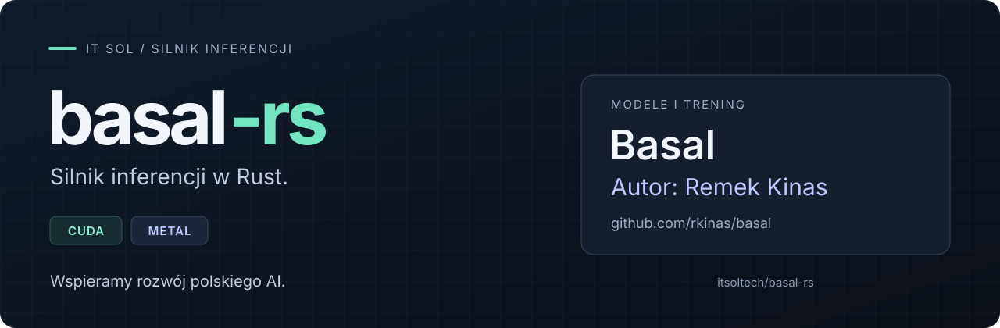

<p align="center">
  
</p>

<h1 align="center">basal-rs</h1>

<p align="center">
  <strong>Silnik inferencji w Rust dla modeli Basal autorstwa Remka Kinasa.</strong>
</p>

<p align="center">
  <a href="https://github.com/itsoltech/basal-rs/actions/workflows/lint.yml"></a>
  <a href="LICENSE"></a>
  <a href="#budowanie"></a>
  <a href="#budowanie"></a>
  <a href="docs/INTEL.md"></a>
</p>

<p align="center">
  <a href="#instalacja">Instalacja</a> ·
  <a href="#wyniki">Wyniki</a> ·
  <a href="#serwer">API</a> ·
  <a href="#dokumentacja">Dokumentacja</a> ·
  <a href="https://github.com/rkinas/basal">Basal upstream</a>
</p>

[Basal](https://github.com/rkinas/basal) — modele, ich trening, wagi i protokół
decyzyjny — jest dziełem **Remka Kinasa**, rozwijanym na bazie modeli Bielik.
Zdolności decyzyjne i jakość odpowiedzi pochodzą z tych modeli.

**Nasz wkład to silnik inferencji i serwer w Rust**, rozwijane przez
[IT SOL](https://github.com/itsoltech): wykonanie obliczeń na GPU, optymalizacja
pakowania żądań, kernele i harmonogram serwera. Backend CUDA (NVIDIA,
sprawdzony na RTX 6000 Ada), Metal (Apple Silicon, sprawdzony na M1 Pro i M2 Max)
oraz [Intel Arc przez Vulkan](docs/INTEL.md) (Linux; pomiary wyłącznie na zintegrowanym
Arc Meteor Lake). Inne karty Arc nie mają jeszcze potwierdzonej poprawności;
[sprawdzony sprzęt i zakres weryfikacji](docs/INTEL.md#sprawdzony-sprzęt-i-zakres-weryfikacji)
opisujemy osobno.
Serwer implementuje istniejący kontrakt API **TypeSafe System One** oraz
endpoint zgodny z serwerem upstream. Atrybucję portowanych elementów Basala
i modeli bazowych zawiera [NOTICE](NOTICE).

Rozwijamy ten silnik, by ułatwiać korzystanie z polskich modeli na NVIDIA,
Apple Silicon i Intel Arc oraz wspierać rozwój polskiego AI.

Runtime odtwarza protokół decyzyjny upstream: ten sam prompt, te same
token IDs, skonfigurowane porządki opcji, uśrednienie i kalibracja z `CALIBRATION.json`.
Różni się sposobem wykonania: pakowaniem promptów w drzewo wspólnych
prefiksów, własnymi kernelami i harmonogramem serwera. Zgodność decyzji
z referencją FP32 oraz różnice numeryczne opisują [pomiary poniżej](#wyniki).

> „Nie będę implementował swojej wersji – Wasza/Twoja jest bardzo dobra i wskażę
> na nią w swoim repo jeśli pozwolicie. Bardzo dobrze zrobione.”
>
> — **Remek Kinas**, autor Basala, po przeglądzie silnika basal-rs.
> [Wpis na X](https://x.com/KinasRemek/status/2107539877839384742)

## Instalacja

```sh
# macOS, Apple Silicon
brew install itsoltech/tap/basal-rs

# Linux x86_64 z kartą NVIDIA (pobiera też biblioteki CUDA; z hosta potrzebny tylko sterownik),
# także macOS bez Homebrew
curl -fsSL https://raw.githubusercontent.com/itsoltech/basal-rs/main/install.sh | sh

basal doctor                # co jest na maszynie, czego brakuje i jak to naprawić
basal serve                 # http://127.0.0.1:8000; przy pierwszym starcie pobiera basal-2.0-4.5B
basal serve --model mini    # inny model: mini, 4.5B, max, owner/nazwa@rewizja albo katalog
```

Plik konfiguracji jest opcjonalny: `basal serve` czyta `basal-serve.yml` z
bieżącego katalogu (`basal init` go zapisuje) albo plik z `--config`.
Aktualizacja: `basal update` (albo
`brew upgrade`), usunięcie wszystkiego: `basal uninstall --models`. Obraz
Docker: [niżej](#uruchomienie-w-dockerze). Wymagania, ścieżki i szczegóły:
[docs/INSTALL.md](docs/INSTALL.md).

## Co wnosi silnik basal-rs

Gemma z PLE może jawnie trzymać tabelę tokenów w RAM hosta:
`basal serve --model omni-mini --ple-placement host` lub per-model YAML
`ple_placement: host`. Domyślnie pozostaje `device`. Warunki, rachunek pamięci
i brak kwalifikacji runtime tej opcji opisuje [OMNI.md](docs/OMNI.md#tabela-ple-w-ram-hosta-opt-in).

- **Wspólny stan liczony raz** — drzewo prefiksów współdzieli obliczenia między pytaniami i żądaniami w partii.
- **Trzy backendy GPU** — własne kernele CUDA, Metal i Intel Vulkan, bez środowiska Pythona w runtime.
- **Serwowanie istniejących API** — kontrakt TypeSafe System One i konwencje serwera Basal; kilka modeli w jednym procesie.
- **Jawne pomiary** — porównania z upstream FP32, opóźnienia i przepustowość wraz z danymi w [reports/](reports/README.md).

## Modele

| Model | Status |
|---|---|
| `Remek/basal-omni-pico` (0.8B), alias `pico` | tekstowy Qwen3.5; CUDA RTX 4060: decyzje zgodne z upstream FP32 w zbadanych zestawach; Metal niepotwierdzony; [użycie i ograniczenia](docs/PICO.md), [zgodność](reports/pico-rtx4060-2026-10-26/README.md), [wydajność v2 i różnice BF16](reports/pico-speed-rtx4060-2026-10-26/README.md), [C1 5k w v3](reports/pico-long-c1-rtx4060-2026-10-26/README.md) |
| `Remek/basal-1.5-max` (11B), rewizja `be1b5ee7` | CUDA, Metal ([M2 Max](reports/metal-m2-max-1.5/README.md), [M1 Pro](reports/metal-m1-pro-1.5/README.md)) |
| `Remek/basal-1.5-4.5B`, rewizja `784a683b` | CUDA ([zgodność](reports/compat-1.5-small/README.md), [wydajność](reports/perf-1.5-small/README.md)), Metal ([M2 Max](reports/metal-m2-max-1.5/README.md), [M1 Pro](reports/metal-m1-pro-1.5/README.md)) |
| `Remek/basal-1.5-mini` (1.5B), rewizja `1978d070` | CUDA ([zgodność](reports/compat-1.5-small/README.md), [wydajność](reports/perf-1.5-small/README.md)), Metal ([M2 Max](reports/metal-m2-max-1.5/README.md), [M1 Pro](reports/metal-m1-pro-1.5/README.md)) |
| `Remek/basal-1.0-4.5B`, rewizja `b9528804` | CUDA, Metal ([M1 Pro](reports/metal-m1-pro/README.md)) |
| basal-2.0 mini / 4.5B / max, podstawowe BF16 | format 2, CUDA H100 i Metal M2 Max; Intel mini/4.5B, max niepotwierdzony; [wyniki i ograniczenia](reports/upstream-2.0-final-2026-10-14/README.md); [kontrakt i aliasy](docs/UPSTREAM_2.0.md) |
| basal-omni mini / max, podstawowe BF16 | natywne Gemma 4 / Unified, CUDA; [realne media, kontekst i wydajność](reports/upstream-2.0-final-2026-10-14/README.md); [obraz i audio](docs/OMNI.md) |

[Pico v4 na RTX 4060](reports/pico-parallel-rtx4060-2026-10-26/README.md):
C1/5080 tokenów 536,42 ms wobec 553,58 ms eager upstream w ABBA.

Nowe aliasy `omni-1.1-max` oraz `omni-ultra` i eksperymentalne zadania upstream 2.1
opisuje [docs/TASKS.md](docs/TASKS.md). Zakres potwierdzenia GPU tych modeli jest
oddzielny od kompilacji i zgodności logiki zadań na CPU.
Pomiary nowych modeli, kontrolę FP32 i rzeczywiste wywołania czterech SDK opisuje
[raport upstream 2.1](reports/upstream-2.1-2026-10-17/README.md).

Modele format 2 mają natywny odczyt 2–255 opcji oraz typ `tool`.
Domyślnie serwujemy `basal-2.0-4.5B`. Aliasy `mini`, `4.5B` i `max` nadal wskazują modele basal-1.5.
Instalacje i usługi bez pliku konfiguracji oraz bez `--model` przechodzą na nowy model.
Pierwszy start pobiera około 9.1 GB wag, jeśli nie ma ich w cache.
Aby zachować basal-1.5, użyj `basal serve --model 4.5B` lub `basal init --model 4.5B`.
Jawna konfiguracja zachowuje swój wybór modeli.

Typy pytań format 1: `choice` (2–10 opcji oraz 11–255 przybliżoną strategią grupową), `noul`,
`score`, a z basal-1.5 także `multi`, `act`, `facts: "auto"` i `evidence`.
Strategia dla ponad 10 opcji jest rozszerzeniem runtime'u, ocenianym osobno od
zgodności z upstream: na zbiorach intencji z 59–150 opcjami basal-1.5-max
odpowiada poprawnie na 156, 182 i 157 z 200 pytań, TypeSafe jev na 159, 185 i
159 ([pomiar](reports/choice-sets/README.md)).

## Wyniki

Porównujemy wykonanie tych samych modeli Basal przez dwa silniki inferencji.
Poniższe wyniki opisują wydajność runtime'u i zgodność z upstream;
zdolności modeli do podejmowania decyzji są zasługą ich autora.

### Zgodność z upstream FP32

900 pytań z dziewięciu publicznych zbiorów (polskie i angielskie; choice,
noul, score) wobec forwardu FP32 upstream v1.5.0: liczba tych samych decyzji
([pomiar](reports/decision-sets/README.md)).

| Model, karta | basal-rs f16 (domyślny) | basal-rs f32 | upstream BF16 (`fast`) |
|---|---:|---:|---:|
| basal-1.5-max, A100 | 900/900 | 900/900 | 896/900 |
| basal-1.5-4.5B, RTX 6000 Ada | 899/900 | 900/900 | 890/900 |
| basal-1.5-4.5B, A100 | 899/900 | 900/900 | ¹ |
| basal-1.5-mini, RTX 6000 Ada | 899/900 | 900/900 | 896/900 |
| basal-1.5-mini, A100 | 900/900 | 900/900 | ¹ |

Jedyne różnice basal-rs f16 to remisy w FP32 (np. 0,503 / 0,497); trafność
wobec etykiet jest taka sama jak w FP32. ¹ Upstream BF16 dla 4.5B i mini
mierzony tylko na RTX 6000 Ada.

### Wydajność na kartach NVIDIA — basal-2.0

Domyślny `basal-2.0-4.5B`, HTTP przy 32 klientach: żądania/s,
upstream v2.0.0 `fast` BF16 / basal-rs FP16, z tych samych checkpointów BF16.
Oba silniki na tej samej maszynie; mediana trzech powtórzeń po odrzuceniu pierwszego.

| Karta | upstream / basal-rs |
|---|---:|
| H100 PCIe | 135,5 / 228,6 |
| A100-SXM4-80GB | 83,4 / 146,6 |
| L40S | 66,8 / 122,8 |
| RTX 6000 Ada Generation | 34,5 / 87,9 |
| RTX A6000 | 36,6 / 69,2 |

[Pełne wyniki](docs/PERFORMANCE.md) obejmują
mini/4.5B/max, 1/8/32 klientów, zakres powtórzeń i opóźnienia. [Raport](reports/perf-basal2-fivegpu-2026-10-14/README.md)
podaje zgodność z FP32 na małym zestawie 49 argmax i 41 odpowiedzi API,
słabsze przypadki wydajności, nieudane starty upstream oraz błędy ruchu mieszanego.
Pomiary historyczne 1.5 pozostają poniżej; warunki obu kampanii różnią się.

### Wydajność na kartach NVIDIA — basal-1.5

Ta sama metodyka na pięciu wynajętych kartach z fabrycznym limitem mocy,
upstream v1.5.0 `fast` na tej samej karcie
([pomiar](reports/perf-gpus/README.md), wszystkie środowiska i
konfiguracje: [docs/PERFORMANCE.md](docs/PERFORMANCE.md)). basal-1.5-max:

| Karta | Pojedyncza decyzja, mediana: upstream / basal-rs | HTTP, 1 klient, p50 / p99 | HTTP, 32 klientów: żądania/s | HTTP, 32 klientów, p50 / p99 basal-rs | Energia na decyzję |
|---|---:|---:|---:|---:|---:|
| H100 80 GB | 14,5 / 17,5 ms | 18 / 21 – 19 / 26 ms | 56 / 85 | 366 / 404 ms | 12,4 / 8,0 J |
| A100 80 GB | 39,9 / 30,3 ms | 45 / 47 – 36 / 44 ms | 24 / 41 | 778 / 838 ms | 16,8 / 9,6 J |
| L40S | 43,7 / 42,3 ms | 52 / 62 – 46 / 52 ms | 18 / 36 | 886 / 935 ms | 19,7 / 9,6 J |
| RTX 6000 Ada | 66,2 / 43,5 ms | 88 / 103 – 53 / 69 ms | 10 / 27 | 1172 / 1244 ms | 29,4 / 11,2 J |
| RTX A6000 | 78,0 / 50,2 ms | 102 / 107 – 65 / 83 ms | 10 / 21 | 1492 / 1621 ms | 31,1 / 14,1 J |

(upstream / basal-rs, HTTP 1 klient: upstream p50 / p99 – basal-rs p50 /
p99.) Na wszystkich kartach i modelach basal-rs obsługuje przy 32 klientach
1,5–2,8 raza więcej żądań niż upstream i zużywa 1,3–2,8 raza mniej energii na
decyzję (wyjątek: basal-1.5-mini na H100, 0,95 przepustowości). Pojedyncza
decyzja jest krótsza na kartach do 300 W, porównywalna na L40S i A100, a na
H100 o 20–35% dłuższa niż w upstream z CUDA graphs. Pod obciążeniem basal-rs
zwraca na to samo żądanie bitowo tę samą odpowiedź; upstream różni się o do
0,068 prawdopodobieństwa. Ruch mieszany (dokumenty do 16k tokenów, 1–14
pytań), basal-1.5-max, 32 klientów: od 121 żądań/min (RTX A6000) do 454 (H100).

### Serwer pomiarów (RTX 6000 Ada)

basal-1.5-max na RTX 6000 Ada z limitem mocy 250 W; upstream v1.5.0
`basal-serve --mode fast` (BF16, torch.compile, CUDA graphs) na tej samej
karcie. Szczegóły i dane:
[reports/rust-cuda-1.5-max](reports/rust-cuda-1.5-max/README.md).

| Pomiar | Upstream | basal-rs |
|---|---:|---:|
| Pojedyncza decyzja (basal-bench, mediana) | 90,7 ms | 63,4–64,0 ms |
| Jedno pytanie przez HTTP, p50 | 118 ms | 72 ms |
| Jedno pytanie przez HTTP, 32 klientów | 6,8 żądania/s | 21,8 żądania/s |
| Dokument 16k tokenów, 5 pytań (300 W) | 112,2 s | 5,3 s |
| Ruch mieszany (stany 0,1–16k tokenów, 1–14 pytań) | 17 żądań/min | 119 żądań/min |

Przy domyślnym limicie 300 W (upstream nie był mierzony w tych warunkach)
basal-rs obsługuje ~20% więcej: 17,3 żądania/s przy jednym kliencie (p50
56 ms), 26,3 żądania/s przy 32 klientach, ruch mieszany 143 żądania/min
([pomiar](reports/rust-cuda-1.5-max/power/README.md)).

Mniejsze modele przy 300 W, ten sam klient, upstream v1.5.0 `fast`
([pomiar](reports/perf-1.5-small/README.md)):

| Pomiar | 1.5-4.5B upstream | 1.5-4.5B basal-rs | 1.5-mini upstream | 1.5-mini basal-rs |
|---|---:|---:|---:|---:|
| Pojedyncza decyzja (mediana) | 31,5 ms | 20,4 ms | 9,9 ms | 7,9 ms |
| Jedno pytanie przez HTTP, 32 klientów | 21,8 żądania/s | 54,5 żądania/s | 60,2 żądania/s | 141,7 żądania/s |
| Ruch mieszany, 32 klientów¹ | 59 żądań/min | 336 żądań/min | 818 żądań/min | 2501 żądań/min |

¹ Dla mini bez dokumentów ~8k i ~16k tokenów (limit 8192 pozycji modelu).

Zgodność basal-1.5-max na CUDA z upstream FP32 na 44 przykładach basal-bench: te same decyzje
44/44; maksymalna różnica logitu 1,3·10⁻⁴ dla ścieżki FP32 i 0,27 dla
domyślnej FP16 (mediana 0,013, maks. różnica prawdopodobieństwa po
kalibracji 0,0008). `multi`, `act`, `facts` i `evidence` dają te same pola
odpowiedzi co upstream; `facts` jest zgodne co do bajtu na 432 stanach.
W opisanych pomiarach CUDA z tabelą GEMM niezależną od partii wynik pytania
nie zależy od tego, z czym trafi do partii (bitowo te same logity
pojedynczo, w partii i pod obciążeniem HTTP).

### Apple Silicon

Apple Silicon (Metal), pojedyncza decyzja (mediana, metodyka basal-bench)
wobec upstream v1.5.0 z MLX: ścieżka serwowana (bf16) i ten sam backend w
f16, w tej samej precyzji co basal-rs:

| Model | M2 Max: MLX bf16 | M2 Max: MLX f16 | M2 Max: basal-rs | M1 Pro: MLX bf16 | M1 Pro: MLX f16 | M1 Pro: basal-rs |
|---|---:|---:|---:|---:|---:|---:|
| basal-1.5-max | 992 ms | 886 ms | 526 ms | 2265 ms | 1969 ms | 1197–1323 ms |
| basal-1.5-4.5B | 427 ms | 372 ms | 235 ms | 955 ms | 823 ms | 495–502 ms |
| basal-1.5-mini | 151 ms | 130 ms | 80 ms | 318–323 ms | 274–276 ms | 170–174 ms |

Na M2 Max basal-rs obsługuje 1,9–2,0 raza więcej decyzji na sekundę niż MLX
f16 i 2,2–2,35 raza więcej niż MLX bf16
([M2 Max](reports/metal-m2-max-1.5/README.md),
[M1 Pro](reports/metal-m1-pro-1.5/README.md)). basal-rs f16 daje decyzje
FP32 na 44/44 przykładach dla trzech modeli; upstream MLX bf16 na
basal-1.5-max zmienia jedną. Na M1 Pro mierzona była wersja z SDPA z MLX w
attention; obecne attention po jednostkach drzewa daje wynik niezależny od
pakowania partii przy tym samym czasie pełnej decyzji
([pomiar](reports/metal-m2-max-tree/README.md)).

## Uruchomienie w Dockerze

Na NVIDIA bez instalacji na hoście. Na Apple Silicon: [instalacja](#instalacja) albo [budowanie z Metal](#budowanie).

Wymagane: sterownik NVIDIA i NVIDIA Container Toolkit. Modele wpisane w
[serve.yml](serve.yml) (repozytorium Hugging Face i rewizja); argumenty po
nazwie obrazu zastępują plik (`docker run ... ghcr.io/itsoltech/basal-rs --model mini`):

```sh
docker compose up -d          # obraz ghcr.io/itsoltech/basal-rs:latest i start
docker compose logs -f        # pobieranie modeli, tabele GEMM, start serwera
curl localhost:8000/health
```

Obraz publikuje tylko wydanie ([release.yml](.github/workflows/release.yml)
wywołuje [docker.yml](.github/workflows/docker.yml) po opublikowaniu paczek).
Tagi wydania `vX.Y.Z`: `vX.Y.Z`, `vX.Y` i `vX` (najnowsze wydanie danej serii)
oraz `latest` (najnowsze wydanie), np. `ghcr.io/itsoltech/basal-rs:v0.1`
przypina serię 0.1 z poprawkami. Push na `main` niczego nie publikuje. Jeden obraz zawiera kernele dla compute
capability 8.0, 8.9 i 9.0 (A100, RTX 30xx/40xx, RTX 6000 Ada, L40S, H100) i
przy starcie wybiera właściwe dla karty. Każdy tag ma też warianty `-sm80` i
`-sm90` (np. `v0-sm80`), nazwy dawnych obrazów per architektura, wskazujące
ten sam obraz. Na RTX
6000 Ada wynik jest bitowo ten sam co z obrazów per architektura
([pomiar](reports/cuda-multi-ptx/README.md),
[obrazy per architektura](reports/docker-images/README.md)).

Przy pierwszym starcie serwer pobiera modele z Hugging Face i generuje dla
nich tabele GEMM (jednorazowo; basal-1.5-mini: ~35 s pobierania i ~150 s
tabeli na RTX 6000 Ada). Oba trafiają do wolumenu `basal-data` (`/data`),
więc kolejne starty trwają kilka sekund, a przy braku dostępu do Hugging Face
serwer wczytuje modele z cache. Repozytoria prywatne: `HF_TOKEN` w
środowisku. `docker stop` zamyka serwer łagodnie (SIGTERM).

Własny build (wieloetapowy: toolkit CUDA i Rust, zależności w osobnej
warstwie przez cargo-chef, obraz wynikowy z samym runtime CUDA):

```sh
docker build -t basal-rs -f docker/Dockerfile .
docker run -d --gpus all -p 8000:8000 -v "$PWD/serve.yml:/config/serve.yml:ro" \
  -v basal-data:/data -e HF_TOKEN basal-rs
```

## Budowanie

Rust stable (sprawdzony na 1.95).

```sh
# Metal (macOS)
cargo build --release

# Intel Arc (Linux, loader Vulkan i sterownik Intel Mesa)
cargo build --locked --release --features basal-cli/intel

# CUDA (Linux, sm_89; obraz z toolkitem: tools/cuda/Dockerfile)
docker build -t basal-dev:cuda tools/cuda
docker run -d --name basal-dev --gpus all --ipc=host -v "$PWD":/work -w /work basal-dev:cuda sleep infinity
docker exec basal-dev cargo build --release --features basal-cli/cuda
```

Kernele CUDA są kompilowane do PTX przez `nvcc` w `crates/basal-gpu/build.rs`
dla architektur z `CUDA_COMPUTE_CAPS` (domyślnie 80, 89 i 90; bez niej
`CUDA_COMPUTE_CAP` wybiera jedną, a kernele candle kompilują się dla
`CUDA_COMPUTE_CAP`). Przy starcie runtime ładuje PTX najwyższej architektury nie
wyższej niż karta. Obraz `basal-dev:cuda` ustawia `CUDA_COMPUTE_CAP=89`.

Intel wymaga osobnego buildu z `basal-cli/intel`, obsługuje forward `f16`
i nie potrzebuje CUDA ani oneAPI. Instrukcje, ograniczenia i pomiary:
[Intel Arc](docs/INTEL.md). Gotowe paczki wydania i obraz Docker nadal dotyczą CUDA/Metal.

## Model

W pliku konfiguracji serwera wystarczy `repo` i `revision` (pobieranie przy
starcie). Ręcznie, np. dla poleceń innych niż `serve`:

```sh
huggingface-cli download Remek/basal-1.5-max \
  --revision be1b5ee7e7a9755a931262fa7fab4f59be0fd03c --local-dir .models/basal-1.5-max
```

Runtime sprawdza przy ładowaniu `config.json`, `basal.json`, szablon czatu i
tokenizer; niezgodność z obsługiwanym kontraktem promptu kończy się błędem.

## Serwer

Opcjonalne [wytrenowane early-exit](docs/EARLY_EXIT.md) obsługuje opublikowany
basal-1.0-4.5B na pojedynczym CUDA z jawnym `--kernels candle --early-exit off`.
Pominięcie `early_exit` i `exit_heads` pozostawia plain backend bez głowic.
Polityka requestu jest izolowana. [Skończony pomiar CUDA FP32](reports/upstream-api-241-trained-2026-10-28/README.md)
dał 32/32 przypadki zgodne z upstream w progu 1e-4 i potwierdził pomijanie
warstw. Pamięć, wydajność i pozostałe konfiguracje pozostają GAP.

Opcjonalne [natywne thinking](docs/THINKING.md) uruchamia generowanie i drugi
readout na osobnym pełnym checkpoincie opublikowanego modelu 2.0 4.5B.
`--think off` jest domyślne i nie ładuje drugiego modelu. Włączenie wymaga
obu przypiętych checkpointów i odpowiedniej pamięci. Skończone pomiary
[J1/J2](reports/upstream-api-241-thinking-rebuild-2026-10-28/README.md) i
[J4](reports/upstream-api-241-gemm-diagnostic-2026-10-29/README.md) na RTX 6000 Ada
objęły tę ścieżkę. Parytet z upstream vLLM ma status FAIL; użytkownik
[zaakceptował](reports/upstream-api-241-gemm-diagnostic-2026-10-29/ACCEPTANCE.md)
te różnice. Pamięć, wydajność, ogólna jakość i inne konfiguracje pozostają
niezakwalifikowane. `--think-numerics inherit` zachowuje
dotychczasową numerykę (domyślnie); opt-in `upstream-bf16-pointwise` wybiera
osobny profil BF16 tylko dla CUDA Llama think, bez gwarancji parytetu.
Odmowy konfiguracji i deklarację obliczeń opisuje [THINKING.md](docs/THINKING.md).

Jeden proces obsługuje jeden lub kilka modeli. Konfiguracja w YAML
([serve.example.yml](serve.example.yml)):

```sh
./target/release/basal serve --config serve.example.yml
```

```yaml
addr: 0.0.0.0:8000
default_model: basal-1.5-max
models:
  - repo: Remek/basal-1.5-max            # pobierany z Hugging Face przy starcie
    revision: be1b5ee7e7a9755a931262fa7fab4f59be0fd03c
  - path: .models/basal-1.5-4.5B         # albo lokalny katalog
  - repo: Remek/basal-1.5-mini
    long_tokens: 0
```

Żądanie trafia do modelu z pola `model` (nazwa z `basal.json` modelu);
`/v1/basal` bez tego pola trafia do `default_model`, a nieznana nazwa daje
błąd 422 z listą obsługiwanych modeli. Każdy model ma własną kolejkę i tor
długich żądań; modele na tym samym GPU dzielą je tak, że krótkie partie
dowolnego z nich idą przed długimi żądaniami. Pamięć GPU to suma wag modeli
tego GPU (bf16/f16: 1.5-max ~23 GB, 1.5-4.5B ~9,5 GB, 1.5-mini ~3,2 GB) plus
aktywacje.

Opcjonalny alias wdrożenia ustawia `basal serve --model mini --name decyzje`
albo `name: decyzje` w konkretnym wpisie `models` w YAML. Alias zastępuje nazwę
źródłową w routingu obu API, `default_model`, odkrywaniu modeli i MCP,
odpowiedziach, health, metrykach oraz katalogu i wynikach trwałych batchy.
TypeSafe nadal wymaga jawnego pola `model`; dla tego przykładu użyj
`"model": "decyzje"`. Nazwa źródłowa nie jest dodatkową trasą.
Alias ma 1–256 znaków ASCII: pierwszy to litera lub cyfra, pozostałe to litery,
cyfry albo `._:/@-`; wielkość liter ma znaczenie. Powtórzone nazwy i alias
równy nazwie źródłowej innego wpisu są odrzucane. Nadal obowiązuje jeden wpis
na model źródłowy; kopie konfiguruje `replica_devices`. `--name` wymaga jednego
modelu i nie łączy się z konfiguracją z pliku, także wybraną automatycznie.
`basal.json`, dobór profilu, dtype, GEMM, kalibracja i checkpointy thinking/early-exit
zachowują źródłową tożsamość. Bez aliasu nazwy pozostają dotychczasowe.
Zmiana aliasu zmienia fingerprint batchy: lokalny katalog odświeża się przy
starcie, a produkcyjny wymaga zgodnego wpisu nowej rewizji katalogu. Stare
batche wymagają workera z poprzednią tożsamością i fingerprintem.

Na CUDA klucz `device` przypisuje model do GPU (domyślnie 0), np. max na
jednej karcie, a 4.5B i mini na drugiej. Modele na różnych GPU liczą
jednocześnie, za tym samym API i z tymi samymi nazwami modeli. Bez
`replica_devices` i `layer_split` (opis niżej) model jest ładowany raz, na
jednym GPU. Numer to indeks CUDA widoczny dla procesu.
`device` i `replica_devices` obsługują wszystkie modele (basal-1.5, Basal 2.0,
Omni). `layer_split` obsługuje Llama oraz Gemma bez współdzielenia KV między
warstwami i bez per-layer input embeddings (w tym Ultra); `quantization`
pozostaje dostępne dla Llama
([macierz](docs/ARCHITECTURE.md#ograniczenia)).
Kolejność wszystkich kart ustala `CUDA_DEVICE_ORDER` (domyślna może różnić się
od `nvidia-smi`, `PCI_BUS_ID` daje kolejność PCI jak `nvidia-smi`), a
`CUDA_VISIBLE_DEVICES` wybiera z niej karty, zmienia ich kolejność i numeruje
od 0. `basal doctor` z tym
samym środowiskiem wypisuje numery CUDA kart i według nich sprawdza pamięć
modeli. Metal i Intel obsługują tylko `device: 0`.
Działanie 4.5B i mini na dwóch RTX 6000 Ada, bitową zgodność z wersją
sprzed zmiany oraz ruch równoległy sprawdzono na sprzęcie
([raport](reports/multigpu-placement-2026-10-11/README.md)); pomiar nie
wyznacza skalowania przepustowości ani zachowania kart różnych architektur.

Repliki (CUDA): `replica_devices: [0, 1]` przy modelu albo
`basal serve --model mini --replica-devices 0,1` ładuje niezależną kopię modelu
na każdą wymienioną kartę pod jedną nazwą w API (`/v1/models` wymienia model
raz). Każda replika ma własną kolejkę, harmonogram, cache i tor długich żądań;
żądanie trafia do dostępnej repliki z najmniejszą liczbą żądań w kolejce i w
trakcie, a remisy rozstrzyga rotacja. Żądanie nie jest ponawiane po
rozpoczęciu obliczeń. Lista musi być niepusta, bez powtórzeń, a karty jednego
typu (nazwa, compute capability, liczba SM); mieszaną grupę serwer odrzuca
przed pobraniem modelu. Repliki używają jednej tabeli GEMM niezależnej od
partii, sprawdzonej na każdej karcie, więc `gemm_table: none` jest wtedy
błędem. `device` i `replica_devices` razem są błędem, także przy `device: 0`;
jeden element listy działa jak `device`. Modele bez replik mogą nadal używać
innych typów kart. Limit `max_inflight` i model domyślny są wspólne. Grupa
jest gotowa, dopóki ma dostępną replikę; zatrzymany worker repliki widać w
`/health` i metrykach. To nie jest wykrywanie awarii sprzętu: CUDA zgłasza
`device_lost` tylko wtedy, gdy instancja nie potwierdziła końca własnej pracy
GPU (dwie nieudane synchronizacje albo wiązania kontekstu), a po niektórych
błędach CUDA proces wymaga restartu, także dla pozostałych kart. Bitowej
zgodności i skalowania replik nie deklarujemy bez pomiaru na sprzęcie.

Podział warstw (opcjonalny, CUDA): `layer_split` przy modelu albo
`--layer-split 0:30,1:30` (`serve --model`, `export`, `decide`, `bench`,
`bench-requests`, `benchmark`, `profile`, `eval-*`) ładuje jeden model na
kilka kart jednego procesu: kolejne zakresy warstw dekodera, po jednym na
kartę, w kolejności warstw. Flaga przyjmuje pary `URZĄDZENIE:LICZBA_WARSTW`,
a YAML listę `{device, layers}`. Dla 4.5B (60 warstw):

```yaml
models:
  - path: .models/basal-1.5-4.5B
    dtype: f16                    # domyślne; podział wymaga f16
    layer_split:                  # zamiast device i replica_devices
      - {device: 0, layers: 30}   # warstwy 0–29 i embedding
      - {device: 1, layers: 30}   # warstwy 30–59, końcowa norma, lm_head, głowica evidence
```

Ultra również ma 60 warstw dekodera. Tekst i obrazy można uruchomić z podziałem:

```sh
basal serve --model omni-ultra --dtype f16 --media --layer-split 0:30,1:30
```

Enkoder obrazu i embedding wejściowy leżą na pierwszej karcie. Ostatnia karta
ma końcową normę oraz drugą kopię powiązanego embeddingu do odczytu kodów.
Maski obrazu, rotary i cache KV są lokalne dla etapu. Podział zachowuje kolejność
obliczeń. [Pomiar Ultra](reports/ultra-multigpu-2026-10-18/README.md) potwierdza
tekst i obrazy na dwóch Ada 48 GB oraz zgodność umieszczenia na H100; opisuje
również skalowanie replik i zachowane różnice względem FP32.
Gemma ze współdzielonym KV między warstwami lub per-layer input embeddings
jest odrzucana przed ładowaniem. Gemma z podziałem wymaga `dtype: f16`,
`quantization: none` i CUDA. Enkodery mediów zachowują BF16.

Etapy liczą po kolei: po warstwach etapu aktywacje granicy są kopiowane na
kartę następnego etapu, a odczyt liter i głowica evidence działają na
ostatnim. To ten sam ciąg obliczeń co na jednym GPU, a nie równoległość
tensorowa ani operacje zbiorcze między kartami. Podział służy pojemności
(wagi i cache K/V każdej warstwy leżą na karcie jej etapu), a nie
przyspieszeniu, i dodaje kopię na każdej granicy. Numery to indeksy CUDA
procesu po `CUDA_VISIBLE_DEVICES`: z `CUDA_VISIBLE_DEVICES=1,0` etap
`0:30` trafia na fizyczną kartę 1.

Przed pobraniem modelu serwer i polecenia odrzucają: mniej niż dwa etapy,
etap bez warstw, powtórzoną kartę, nieznane pole YAML, build inny niż CUDA,
`dtype` inne niż `f16`, `--kernels candle`, indeks spoza kart procesu oraz
karty różnych typów (nazwa, compute capability, liczba SM). Błędem jest też
`layer_split` razem z `device` (także `device: 0`) albo `replica_devices`,
a `--layer-split` razem z `--device`, `--replica-devices` albo `--config` (w
pliku konfiguracji `layer_split` ustawia się przy modelu). Po odczytaniu
`config.json`, przed tabelą GEMM i wagami, suma liczb warstw musi równać się
liczbie warstw modelu (mini 32, 4.5B 60, max 50). Tabelę GEMM serwer
rozwiązuje na karcie etapu 0 i sprawdza na każdej karcie podziału;
`gemm_table: none` działa jak na jednym GPU. `quantization` dotyczy każdego
etapu, z tymi samymi zastrzeżeniami co wyżej (domyślne `none`, opcjonalne
`q8_0`, eksperymentalne `q4_k`). `basal doctor` sprawdza te reguły bez
ładowania modelu i podaje szacunek wag każdego etapu z arytmetyki formatu
(szacunek, nie pomiar). Bez `layer_split` nic się nie zmienia.

W serwerze model z podziałem jest jedną instancją, bez replik. Korzysta z
gate'u każdej swojej karty, ale trzyma najwyżej jeden naraz, więc na każdej
karcie dzieli ją z innymi modelami jak model jednego GPU.
[Pomiar L1](reports/multigpu-layer-l1-revalidation-2026-10-13/README.md)
bieżących źródeł (dwie RTX 6000 Ada 48 GB, mini i 4.5B, `none`, `q8_0`,
`q4_k`): eksporty z podziałem (m.in.
`0:30,1:30`, `0:1,1:59`, `0:59,1:1`, `1:30,0:30`, `CUDA_VISIBLE_DEVICES=1,0`,
900 pytań) są bajtowo równe eksportom jednego GPU w tym samym trybie,
odpowiedzi HTTP są równe referencji jednego GPU, a 38 niepoprawnych
konfiguracji kończy się błędem przed pobieraniem i ładowaniem (według
komunikatów; brak alokacji GPU w tych procesach nie został zmierzony). Pod
sztucznym
limitem (rezerwacja zostawiająca 7939 MiB wolnej pamięci na każdej karcie)
4.5B `none` na jednym GPU kończy się czystym OOM, a `0:30,1:30` działa i daje
bitowo równe wyniki. Bez takiego limitu 4.5B mieści się na jednej karcie
48 GB. Pomiar nie obejmuje modelu max, innych kart (np. RTX 4090), kart
mieszanych, fizycznego braku pamięci ani fizycznej trasy kopii (P2P albo
przez hosta).

Wydajność bieżących źródeł zmierzono dla 4.5B w osobnych sesjach, każda na
maszynie z dwiema RTX 6000 Ada 48 GB; nie ustalono, czy sesje miały te same
fizyczne karty ([zestawienie](reports/multigpu-layer-revalidation-2026-10-14/README.md),
[L2](reports/multigpu-layer-l2-revalidation-2026-10-14/README.md) `none`,
[L3](reports/multigpu-layer-l3-revalidation-2026-10-14/README.md) `q8_0` i
`q4_k`). Każdy stosunek niżej pochodzi z jednej sesji; wyniki różnych sesji
zestawiamy tylko opisowo. Pojedyncze żądanie jest z podziałem wolniejsze: w
`none` przepustowość HTTP jednego klienta to 0,963–0,973 przepustowości
jednego GPU, a w `basal bench` mediana stosunku latencji pytania w parach
wynosi 1,004–1,009 (`none`), 1,128–1,139 (`q8_0`) i 1,183–1,206 (`q4_k`).
Przy 16 klientach mieszanego ruchu `none` z podziałem miał w tej sesji
1,17–1,18× przepustowość jednego GPU, ale karta jednego GPU pracowała wtedy
goręcej i z niższym zegarem; to nie jest obietnica przyspieszenia.

Na torze jednego GPU kandydat ma wobec `d42a400` dwa utrzymane sygnały
reguły bez progu, bez wskazanej przyczyny w kodzie: `none`
`mixed-c1 queue_ms.p99` w `basal benchmark` (+1,2 do +11,3 ms; użytkownik
przyjął ten wynik, [decyzja](reports/multigpu-layer-l2-revalidation-2026-10-14/DECISION.md))
i `q4_k` `dec_s` w `basal bench` (−0,01 do −0,56%; koordynator przyjął go w
granicy 1–2% podanej wcześniej przez użytkownika,
[rozstrzygnięcie](reports/multigpu-layer-l3-revalidation-2026-10-14/DECISION.md)).
Sygnały pozostają w raportach, a rozstrzygnięcia nie tworzą progu. Pozostałe
sygnały się nie utrzymały, co nie dowodzi braku narzutu. Wydajności HTTP
jednego GPU w `q8_0` i `q4_k` dla tego kandydata nie zmierzono. Pomiary
poprzedniego kandydata ([zestawienie](reports/multigpu-layer-2026-10-13/README.md),
[poprawka zakresu](reports/multigpu-layer-2026-10-13/SCOPE.md)) pozostają
historią. Zestawienie oraz raport, rozstrzygnięcie i fakty L3 błędnie
podają, że `load_s` w `d42a400` obejmował wczytanie głowicy evidence, uchwyt
cuBLASLt i synchronizację publikacji. W obu wersjach zegar kończy się przed
głowicą i uchwytem, a synchronizację publikacji ma tylko kandydat, także poza
`load_s` ([erratum](reports/multigpu-layer-revalidation-2026-10-14/LOAD_S.md)).

Kwantyzacja W8A16 (opcjonalna, CUDA): `quantization: q8_0` przy modelu albo
`--quantization q8_0` (`serve --model`, `export`, `bench`, `benchmark`,
`decide`, `profile`, `eval-*`) trzyma na GPU cztery macierze projekcji każdej
warstwy (q|k|v, o, gate|up, down) jako bloki GGML Q8_0 (32 wartości wzdłuż K,
skala f16, int8), kwantyzowane raz przy ładowaniu z dokładnych wartości bf16
checkpointu. Przed każdym GEMM projekcji macierz jest dekwantyzowana do
przejściowego tensora f16 i liczona tym samym GEMM cuBLASLt f16 co gęste wagi;
aktywacje pozostają f16. Embedding, normy, biasy, lm_head, attention, cache
K/V, odczyt liter i głowica evidence są bez zmian, tak jak tabela GEMM
(`{model}-f16`) i kontrakt HTTP. Opcja zmniejsza pamięć wag projekcji kosztem
dodatkowej pracy na każdy forward; nie przyspiesza obliczeń. Wymaga `dtype:
f16` i domyślnych kerneli `fused`; inna kombinacja, Metal, Intel albo flaga
`--quantization` razem z plikiem konfiguracji to błąd przed pobraniem modelu.
`basal doctor` zgłasza te same błędy i szacuje pamięć wag `q8_0` z arytmetyki
formatu.

Domyślne i zalecane jest `none`. `q8_0` zmienia numerykę i wyniki modelu, więc
nie obiecujemy zgodności z FP32 upstream. Opcja jest dla tych, którzy za
mniejszy rozmiar wag projekcji akceptują opisane niżej różnice jakości.
[Pomiar](reports/multigpu-w8-quality-2026-10-11/README.md) (częściowy;
basal-1.5-mini i basal-1.5-4.5B, CUDA f16, RTX 6000 Ada) wykazał:

- granice fragmentów evidence zmienione w 3 pytaniach endpointu (mini: 2,
  4.5B: 1, z 55 na model); f16 bez kwantyzacji zachowało je w tej samej sesji;
- na 900 pytaniach diagnostycznych nowe decyzje różne od FP32: 3 w mini i 5 w
  4.5B. Liczby pomijają pytania, w których różni się też f16: w mini jedno ma
  tę samą różnicę w `q8_0`, a w 4.5B w jednym `q8_0` zachowuje decyzję FP32,
  którą f16 zmienia;
- poprawne odpowiedzi FP32 / f16 / `q8_0`: mini 664 / 663 / 664, 4.5B
  703 / 702 / 704. Nowe zmiany poprawiają i pogarszają odpowiedzi (mini: 2
  poprawy i 1 pogorszenie, 4.5B: 3 i 2); wynik tej próbki nie dowodzi
  zachowania jakości w ogólności.

W `basal compare` decyzje 44 przykładów bench `q8_0` są takie jak FP32
(44/44), ale prawdopodobieństwa się różnią, a porównanie odpowiedzi endpointu
z FP32 nie spełnia kryterium zgodności (granice evidence wyżej). Odpowiedzi
HTTP serwera mini `q8_0` na 34 żądania System One (status i treść) są zgodne
z natywną referencją `q8_0` tych samych wejść (eksport, a dla dwóch przypadków
nieobsługiwanych przez eksport `basal decide`), a dwie repliki na dwóch kartach
dają odpowiedzi równe pojedynczemu `q8_0`; to zgodność wewnętrzna `q8_0`, nie
z FP32.

Kompromis pamięci i czasu zmierzono na RTX 6000 Ada 48 GB, CUDA f16, na jednej
karcie, z żądanym zegarem SM 1200 MHz i limitem mocy 300 W
([raport W8A16](reports/w8a16-2026-10-11/README.md)). Zajętość puli
alokatora CUDA po załadowaniu (`memory_pool.resident_after_load`: wagi,
prefiksy i workspace; bez kontekstu CUDA, modułów i alokacji synchronicznych,
nie cały VRAM ani jego szczyt) spadła w 4.5B z 9 644 216 320 do
5 309 140 480 B, w mini z 3 271 867 392 do 1 868 155 904 B. Czas 4.5B wzrósł:
mediana `latency2` w `basal bench` z około 25,5 do 42,4–42,6 ms (1,66–1,67×
w każdej z czterech par), p50 sekwencyjnych żądań `basal benchmark` z około
26,8–27,0 do 43,0–43,3 ms, a p50 mieszanego ruchu przy 16 klientach z około
586–598 do 673–675 ms. To wyniki tych obciążeń przy tym zegarze, nie stały
mnożnik; w tych pomiarach `q8_0` wydłużyło latencję i obniżyło przepustowość.
Model max, inne karty, zegary, obciążenia i ustawienia nie zostały zmierzone.

Z domyślnym `none` eksporty mini i 4.5B są bitowo równe wersji bez tej opcji,
a pomiar czasu 4.5B nie wykazał powtarzalnego spadku przy swojej rozdzielczości
([pomiar](reports/multigpu-w8-none-2026-10-11/README.md)); nie jest to dowód
zerowego narzutu.

Kwantyzacja W4A16 (opcjonalna, eksperymentalna, CUDA):
`quantization: q4_k` albo `--quantization q4_k` działa jak `q8_0` (te same
cztery projekcje, polecenia, wymagania `dtype: f16` i kerneli `fused`, ta sama
walidacja przed pobraniem modelu i odmowa dla Metal i Intel), ale z blokami
GGML Q4_K: 256 wartości wzdłuż K w 8 grupach po 32, 6-bitowe skale i minima
grup względem skal f16 bloku, kody 4-bitowe (144 B na 256 wartości). Każde K
projekcji musi być wielokrotnością 256 (spełniają to kształty mini, 4.5B i
max); przy znanym `config.json` `basal doctor` zgłasza inny przypadek jako
błąd. Ładowanie dodatkowo rekonstruuje każdą macierz na CPU, odrzuca wartości
nieskończone wag i rekonstrukcji oraz stałe niezerowe grupy 32 wartości
(przypięty kwantyzator Candle zamienia je na zera) i porównuje bitowo
dekwantyzację jednej macierzy na GPU z rekonstrukcją na CPU; to kontrola
jednej macierzy, nie dowód dla pozostałych. Opis backendu (obiekt
`quantization`) podaje błąd rekonstrukcji wag i liczniki grup. Format wybrano
regułą ustaloną przed pomiarem, na podstawie błędu w przestrzeni wag
([raport P0](reports/w4a16-p0-2026-10-12/README.md)); to nie jest ocena
jakości odpowiedzi. Arytmetyka formatu daje dla bloków projekcji 4.5B
2 601 192 960 B wobec 4 913 364 480 B przy `q8_0` (z paddingiem Candle); to
nie jest pomiar puli pamięci ani VRAM.

Domyślne i zalecane jest `none`; `q4_k` to tryb eksperymentalny, włączany
tylko jawnie. Zmienia numerykę i wyniki modelu; w tym pomiarze różnice wobec
FP32 były wyraźnie większe niż dla `q8_0`, a kryterium zgodności z FP32
upstream nie jest spełnione na żadnym z dwóch zmierzonych modeli. Ocena
i wybór `q8_0` opisane wyżej nie obejmują `q4_k`.
[Pomiar](reports/w4a16-s1-2026-10-12/README.md) (basal-1.5-mini
i basal-1.5-4.5B, CUDA f16, RTX 6000 Ada, jedna sesja) wykazał:

- na 44 przykładach bench, 34 żądaniach System One i 55 pytaniach endpointu
  26 naruszeń kryterium FP32 w 15 pozycjach (mini) i 20 w 12 (4.5B): zmienione
  decyzje bench i endpointu oraz granice fragmentów evidence; f16 bez
  kwantyzacji ma w tej samej sesji 0 naruszeń, a jedna pozycja może dać kilka;
- na 900 pytaniach diagnostycznych nowe decyzje różne od FP32 (bez pytań,
  które zmienia już f16): 76 w mini i 81 w 4.5B (`q8_0`: 3 i 5);
- poprawne odpowiedzi FP32 / f16 / `q4_k`: mini 664 / 663 / 668, 4.5B
  703 / 702 / 685. Nowe zmiany poprawiają i pogarszają odpowiedzi (mini: 38
  popraw i 33 pogorszenia, 4.5B: 25 i 43). Wynik +5 wobec f16 w mini dotyczy
  tej próbki i nie oznacza poprawy ani równoważności jakości; w 4.5B `q4_k` ma
  o 17 poprawnych odpowiedzi mniej niż f16.

Eksporty `q4_k` są bitowo równe między kartami, trybami pakowania,
`--no-prefix-cache` i `CUDA_VISIBLE_DEVICES`. Odpowiedzi HTTP serwera mini
`q4_k` są równe natywnej referencji `q4_k` tych samych wejść, a dwie repliki na
dwóch kartach dają odpowiedzi równe pojedynczemu serwerowi; to zgodność
wewnętrzna `q4_k`, nie z FP32. Zajętość puli alokatora CUDA po załadowaniu mini
(jeden przebieg; bez kontekstu CUDA, modułów i alokacji synchronicznych, nie
cały VRAM) wyniosła 1 119 439 872 B wobec 1 868 155 904 B przy `q8_0`
i 3 271 867 392 B bez kwantyzacji.

Kompromis pamięci i czasu 4.5B `q4_k` zmierzono na GPU 0 karty RTX 6000 Ada
48 GB, CUDA f16, z żądanym zegarem SM 1200 MHz i limitem mocy 300 W, w dwóch
osobnych sesjach, w parach ustalonych przed pomiarem. Wyniki są opisowe: bez
kryterium szybkości i bez ustalonej przyczyny różnic.

- Wobec f16 bez kwantyzacji ([S2](reports/w4a16-s2-2026-10-12/README.md)):
  p50 sekwencyjnych żądań `basal benchmark` wzrosło o 56,5% i 56,8% (z około
  27 do około 42 ms), żądania/s spadły o 33,2% sekwencyjnie oraz o 7,4% i 7,2%
  w ruchu mieszanym przy 16 klientach, a mediana ilorazu `latency2` per
  pytanie w `basal bench` wynosi 1,60. Zajętość puli alokatora po załadowaniu
  spadła z 9 644 216 320 do 2 996 968 960 B. `load_s` benchmarku wzrósł
  z 11,5–12,8 do 25,4–25,5 s; obejmuje kwantyzację na hoście, której czasu
  nie mierzymy osobno.
- Wobec `q8_0` ([S3](reports/w4a16-s3-2026-10-12/README.md)): żądania/s
  wzrosły o 1,37% i 1,70% sekwencyjnie oraz o 0,43% i 0,66% przy 16 klientach,
  mediana ilorazu `latency2` per pytanie (`q4_k` / `q8_0`) wynosi 0,977, a pula
  po załadowaniu to 2 996 968 960 wobec 5 309 140 480 B.

Mniejsza pamięć wag `q4_k` kosztuje więc wobec f16 wyraźnie więcej czasu;
`q4_k` nie jest ogólnie szybsze ani lepsze jakościowo. S2 i S3 to osobne
sesje, więc ich wyników nie łączymy w porównanie f16 z `q8_0`. Pula (jak
wyżej) nie jest całym VRAM ani jego szczytem. Szybkość żądań mini, model max,
inne karty, zegary i obciążenia nie zostały zmierzone.

Z `none` i `q8_0` zmierzone w S1 eksporty mini i 4.5B są bitowo równe wersji
sprzed dodania `q4_k`. Pomiar czasu 4.5B z `none` nie wykazał powtarzalnego
spadku przy swojej rozdzielczości (S2); nie jest to dowód zerowego narzutu.
Z `q8_0` przepustowość ruchu mieszanego przy 16 klientach była niższa niż
w wersji sprzed zmiany we wszystkich czterech parach, o 0,11–0,37% (S3).
Przyczyny nie ustalono i nie twierdzimy, że to szum ani że regresji nie ma;
użytkownik zaakceptował ten zaobserwowany spadek jako kompromis, bez nowego
progu. Synchronizowany profil sekcji `q8_0` (batch 1, jeden proces na wersję)
był w nowej wersji wolniejszy o 17,6%, w tym dekwantyzacja o 40,3%; nie jest
to latencja żądań ani wykazana przyczyna tej różnicy.

Jeden model bez pliku konfiguracji:

```sh
./target/release/basal serve --model .models/basal-1.5-max \
  --gemm-table reports/rust-cuda-1.5-max/gemm-equiv/gemm-algos-f16-invariant-groups.json \
  --addr 0.0.0.0:8000
```

| Endpoint | Opis |
|---|---|
| `POST /v1/systemone` | TypeSafe System One: ścisła walidacja, odpowiedzi i confidence TypeSafe, rozszerzenia basal-1.5 |
| `POST /v1/basal` | natywny kontrakt upstream v2.4.1: `confidence = max(p)`, validation/usage/unsupported 422, Internal 500, rozpoznany OOM 503, admission 529 + `Retry-After`; body błędów `{"error"}`. [Cztery SDK](docs/SDK.md) zachowują natywną trasę i raw dodatki thinking/early-exit. |
| `GET /v1/models` | lista modeli TypeSafe z polami upstream `mode` i `early_exit` |
| `GET /health` | gotowość: 200 `{"status":"ok"}`; 503 `{"status":"device_lost"}` z `lost_models`, gdy backend modelu z jedną instancją (także z podziałem warstw) zgłosił trwałą utratę: Intel Vulkan po utracie urządzenia, CUDA gdy nie potwierdził końca własnej pracy GPU (dwie nieudane synchronizacje albo wiązania kontekstu); to nie test sprzętu. Grupy replik: 200 z `degraded_models`, gdy część replik jest niedostępna; 503 `{"status":"engine_stopped"}` z `unavailable_models`, gdy żadna. Wpis: `{"model", "replicas", "available", "unavailable": [{"replica", "device", "reason": "worker_closed" \| "device_lost"}]}` |
| `GET /metrics` | opcjonalne metryki Prometheus: żądania, opóźnienia, tokeny, kolejka i partie, z podziałem na modele i ich repliki |

`basal serve --mcp on` (YAML `mcp: "on"`, domyślnie `"off"`) dodaje
stateless streamable HTTP `/mcp` z narzędziami `decide` i `decide_many`.
`basal mcp --url http://127.0.0.1:8000 --timeout 60` jest mostem stdio do
już działającego serwera, bez ładowania wag. Oba korzystają z natywnego
domyślnego modelu. Kontrakt, limity i Host/Origin: [MCP](docs/MCP.md).

Odpowiedzi `/v1/systemone` i `/v1/basal` mają nagłówki `x-basal-queue-ms`, `x-basal-compute-ms` i
`x-basal-batch-requests`.

Metryki są domyślnie wyłączone. Włącza je `basal serve --metrics` albo
`metrics: true` w `basal-serve.yml`; endpoint działa na tym samym porcie co API.
Konfiguracja Prometheusa,
definicje liczników oraz zapytania p50/p99: [Observability](docs/OBSERVABILITY.md).

Opcjonalne `/v1/batches` i `/v1/files` obsługują trwałe zlecenia JSONL w formacie
`/v1/basal`, z oknem 24h i pierwszeństwem ruchu online. Funkcja jest domyślnie
wyłączona; wykonywanie GPU wymaga osobnej kwalifikacji profilu. Lokalny start,
magazyny SQLite/PostgreSQL/SQL Server/MongoDB, autoryzacja oraz bieżące ograniczenia:
[Batch API](docs/BATCHES.md). Baza (backend, poświadczenia, TLS, pula, migracje)
ma osobną, opcjonalną sekcję `database:` i polecenie `basal database migrate`:
[Baza danych](docs/DATABASE.md). Zgodność numeryczna i obciążenie mieszane batch/online
pozostają do potwierdzenia na GPU; sama dostępność endpointu ich nie potwierdza.

```sh
curl --fail-with-body localhost:8000/v1/systemone -H 'content-type: application/json' -d '{
  "model": "basal-1.5-max",
  "state": "Zgłoszenie: klient prosi o zwrot pieniędzy za uszkodzony telefon.",
  "questions": {
    "dept": {"type": "choice", "instructions": "Do którego działu skierować zgłoszenie?",
             "criteria": {"returns": "Zwroty", "tech": "Wsparcie techniczne", "sales": "Sprzedaż"}},
    "urgent": {"type": "noul", "instructions": "Czy sprawa jest pilna?"}
  }
}'
```

Opcjonalne główne pole YAML `long_share` lub `serve --long-share` ustawia jeden
cel udziału długiego toru dla każdej współdzielonej bramki urządzenia. Jawna
flaga CLI nadpisuje YAML także przy `--config`, `BASAL_CONFIG` i automatycznym
wyborze `basal-serve.yml`. Brak obu ustawień zachowuje dotychczasową politykę.
Wartość musi być skończona i należeć do `[0,1]`; błędna blokuje start przed
pobieraniem modeli, rozpoznawaniem GPU, wyborem GEMM i ładowaniem wag.
Pole jest globalne: `models[].long_share` jest błędem konfiguracji.

Długi tor ustępuje między warstwami, gdy główny tor czeka, minęło co najmniej
`long_slice_ms` (domyślnie 100 ms) nieprzerwanego posiadania bramki, a jego
ostatni udział jest co najmniej równy celowi. `0` zachowuje warunek ustępowania
legacy; `1` wyłącza ustępowanie w trakcie forwardu. Nowe długie zadanie nadal
czeka na główny tor, a zakończenie forwardu zwalnia GPU. Udział ma ciągłą
pamięć wykładniczą o stałej 2 s i sumuje czas posiadania bramki przez oba tory
online wszystkich modeli na urządzeniu. Bezczynność, tło i czas rezerwacji
nie zwiększają udziałów, tylko wygaszają historię. To czas zajęcia bramki,
bez gwarancji wykorzystania GPU, przepustowości ani sprawiedliwości.

Ustawienie nie tworzy torów ani dodatkowych bramek, nie zmienia liczby workerów
i nie wybiera klasy żądania. Nadal obowiązuje próg `long_tokens`; bez aktywnego
długiego toru cel nie wpływa na wykonanie. Każde urządzenie ma własną bramkę
wspólną dla modeli, replik i etapów podziału, gdy wymaga tego dotychczasowa
serializacja. Startup podaje cel oraz obecność długiego toru na urządzeniu.

Opcje modelu (klucze YAML w `models`; dla jednego modelu te same opcje
wiersza poleceń, np. `--max-batch-tokens`):

Layout, kalibrację, progi `orders: auto` i politykę długiego kontekstu można ustawić także w `decide`,
`prepare`, `check-prompts`, `export`, poleceniach pomiarowych z opcjami GPU
oraz `client --local`. Przykład:

```sh
basal serve --model 2.0-mini --layout qfirst --no-calibration --orders auto --auto-tau 0.6 --auto-band 0.2 0.8
```

Jawne `--think`, `--think-numerics`, `--think-tokens`, `--think-max-len`, `--think-calibration`,
`--layout`, `--calibration` / `--no-calibration`, `--strict-calibration`,
`--auto-tau`, `--auto-band`, `--context-overflow` i `--truncate-head` nadpisują odpowiednie ustawienia **każdego** modelu
z YAML, również przy `--config`. CLI wybiera jedno źródło kalibracji zamiast
źródła z YAML; `--calibration` i `--no-calibration` wykluczają się. Brak tych
flag zachowuje YAML. `--strict-calibration` włącza strict; brak flagi nie wyłącza
strict z YAML. Dotychczasowe `orders` ma inne pierwszeństwo: wartość modelu
w YAML, następnie wspólne `--orders`, następnie domyślna wartość formatu.
Ścieżki kalibracji, jak lokalne ścieżki modeli, są względem katalogu procesu.

`--context-overflow refuse|truncate` domyślnie odmawia przekroczenia kontekstu
(upstream 2.4.1 domyślnie skraca). `truncate` usuwa środek stanu, zachowując
pytania i opcje; `--truncate-head` to skończony udział początku w [0,1], domyślnie
1/3. Faktyczne skrócenie opisuje `usage.truncated`. Media nadal odmawiają
przekroczenia kontekstu, a evidence ze skracanym stanem otrzymuje 422 przed GPU.
Planer `truncate` dodatkowo sonduje grupę najdłuższych opcji; to heurystyka BPE.
Rzeczywiste późniejsze rundy są sprawdzane przed GPU w obu politykach.
Przekroczenie limitu odmawia całego danego planu (422), zachowując wyniki innych żądań mikroserii.
Szczegóły i granice: [SYSTEM_ONE.md](docs/SYSTEM_ONE.md#długi-kontekst).

Procesowy `--log-decisions FILE` lub YAML `log_decisions` dopisuje jeden JSONL
z hashem oryginalnego wejścia i końcowymi prawdopodobieństwami żądania online
w obu dialektach, po wszystkich rundach. Domyślnie jest wyłączony; błąd otwarcia
blokuje gotowość. Pełna ograniczona kolejka czeka asynchronicznie; zatrzymany
writer lub błąd zapisu daje 500. Zawartość i lifecycle:
[OBSERVABILITY.md](docs/OBSERVABILITY.md#rejestr-decyzji).

| Klucz | Domyślnie | Znaczenie |
|---|---|---|
| `repo`, `revision` | | repozytorium Hugging Face `owner/name` i gałąź, tag albo commit (domyślnie `main`); pobierane do cache Hugging Face (`HF_HOME`, w obrazie `/data/hf`), przy braku dostępu do Hub z cache |
| `path` | | lokalny katalog modelu (zamiast `repo`) |
| `layout` | deklaracja `basal.json`, inaczej `canonical` | `canonical`, `qfirst` lub `state_twice`; dwa ostatnie wymagają prompt format 2 |
| `context_overflow` | `refuse` | `refuse` lub `truncate`; skracanie dotyczy tekstu |
| `truncate_head` | 1/3 | skończony udział początku zachowanego stanu w [0,1] |
| `orders` | format 1: `2`, format 2: `1` | `1`, `2`, `auto` lub `2le<N>` |
| `calibration`, `no_calibration` | automatycznie | jawny plik albo wyłączenie (`true`); wzajemnie wykluczające się |
| `strict_calibration` | `false` | jawny plik dla innego modelu lub rozpoznanej rewizji HF odmawia startu; bez strict ostrzega i zachowuje progi |
| `auto_tau`, `auto_band` | `0.6`, `[0.2, 0.8]` | progi drugiego porządku przy `orders: auto`; wszystkie liczby muszą być skończone i w `[0,1]`, LO ≤ HI, dokładnie dwie granice |
| `gemm_table` | `auto` | tabela algorytmów cuBLASLt (opis niżej); `pinned` albo `sha256:<digest>`: tryb odtwarzalny, tylko tabela przypięta przez profil modelu albo wskazana digestem, jej brak to błąd; `none`: Llama dobiera algorytmy przy pierwszym użyciu, Gemma wykonuje osobne GEMM dla promptów; albo ścieżka tabeli |
| `dtype` | `auto` | Llama: `f16`; zmierzone Omni mini/max/1.1 max na RTX 6000 Ada oraz Ultra na H100 PCIe: `f16`, pozostałe Gemma: `bf16`; jawne `f16`, `bf16` lub `f32` mają pierwszeństwo |
| `inference_mode` | `auto` | dobór attention; `accurate`: pierwotne attention Llamy lub iloczyny FP32 Gemmy; `balanced`: CUDA Llama f16, softmax i akumulacja f32, prawdopodobieństwa hi/lo |
| `quantization` | `none` | format wag projekcji modeli Llama (basal-1.5, Basal 2.0 mini/4.5B/max): `none` (gęste wagi `dtype`), `q8_0` (8-bitowe wagi z aktywacjami f16) albo `q4_k` (4-bitowe wagi z aktywacjami f16, eksperymentalne; K projekcji wielokrotnością 256); tylko CUDA z `dtype` f16 (`auto` dla Llamy to f16); Omni (Gemma) odrzuca inne wartości niż `none` po odczytaniu `config.json`, przed ładowaniem; opis niżej |
| `device` | 0 | GPU modelu: indeks urządzenia CUDA widoczny dla procesu; modele z tym samym `device` dzielą GPU, z różnymi liczą jednocześnie; Metal i Intel: tylko 0 |
| `replica_devices` | | CUDA: repliki modelu pod jedną nazwą, po jednej na każdy podany indeks (różne karty jednego typu); zamiast `device`; kilka wymaga `gemm_table` `auto` albo ścieżki: Llama wspólnej tabeli niezależnej od partii, Omni bez pasującej tabeli używa stałych GEMM per prompt |
| `layer_split` | | CUDA, Llama oraz Gemma bez współdzielonego KV/PLE: jeden model na kilku kartach jednego typu, lista `{device, layers}` w kolejności warstw (co najmniej dwa etapy na różnych kartach, suma równa liczbie warstw modelu); wymaga `dtype` f16 (`auto` dla Llamy to f16); zamiast `device` i `replica_devices`; Gemma wymaga jawnego f16 i dense `none`; tekst i obrazy z enkoderem na pierwszej karcie; opis wyżej |
| `soam` | `on` | `on`: dotychczasowy Tree; `off`: Budget i gotowe gałęzie prymitywne jako wpisy głównego toru tekstowego |
| `max_batch_tokens` | 8192 | tokeny jednej partii: trie przy SOAM-on, suma spakowanych wierszy gałęzi przy off |
| `max_batch` | brak | dodatni limit wpisów w jednej partii: gotowych gałęzi zwykłego tekstowego SOAM-off, całych żądań przy SOAM-on i wyjątkach atomowych; niezależnie dla głównego i długiego toru |
| `wait_ms` | brak | skończone nieujemne milisekundy stałego okna zbierania głównego toru |
| `batch_window_ms` | brak | skończone nieujemne milisekundy okna adaptacyjnego głównego toru; `0` wyłącza adaptacyjne czekanie |
| `schedule` | `hrrn` | kolejność przyjmowania żądań: `hrrn` (krótkie przed długimi, bez zagłodzenia) albo `fifo` |
| `long_tokens` | 4096 | ścisły próg `>` w wybranej podstawie; oddawanie GPU między warstwami podlega głównej polityce `long_share`; `0` wyłącza tor w trybie legacy |
| `long_lane` | `legacy` | `legacy`: tor aktywny przy dodatnim `long_tokens`; `off`: wyłączony niezależnie od progu; `on`: wymaga dodatniego progu |
| `long_token_basis` | `packed` | `packed`: dotychczasowy koszt admission całego planu; `prompt`: najdłuższy rzeczywisty prompt po truncation lub konserwatywna granica późniejszej pracy |
| `state_cache_mb` | 0 | cache K/V stanu między żądaniami |

`--long-lane legacy|on|off` i `--long-token-basis packed|prompt` nadpisują
odpowiednie pola każdego modelu tylko przy jawnym podaniu, również z `--config`,
`BASAL_CONFIG` i automatycznie znalezionym YAML. Bez opcji pozostają wartości
YAML, a bez obu źródeł — legacy/packed. Nieznane wartości i `on` z progiem 0
odmawiają startu przed pracą modelu/urządzenia. `off` usuwa dodatkowy silnik,
wątek i naliczenie pamięci PLE, zachowując bramki wspólnego GPU i batchy w tle.
Log startu rozróżnia żądane kontrole oraz efektywny tor, próg i podstawę.

`prompt` liczy maksimum `orders[].input_ids.len()` po renderowaniu, tokenizacji
i ewentualnym skróceniu kontekstu, także znanych odwrotnych porządków. Wiele
krótkich pytań bez dłuższej pracy zależnej może pozostać w głównym torze,
mimo przekroczenia progu packed. Nieznane jeszcze finały grouped choice,
kontynuacje tasks i aktywne thinking otrzymują konserwatywną granicę kontekstu,
więc mogą trafić do long mimo krótkich pierwszych promptów. Evidence bez
dowiedzionej zgodności z zaplanowanym promptem również trafia do long.
Szczegóły i granice dowodu: [architektura](docs/ARCHITECTURE.md).
Całe żądanie wybiera tor raz; cache-hit nie skraca klasyfikacji. Koszt HRRN,
budżet tokenowy i limity/rezerwacje żądań pozostają niezależne od tej podstawy.
Natywne FIFO/HRRN zachowują swoje reguły; nie jest to scheduler upstream ani
short-first backlog. Główne `long_share` nadal dotyczy wspólnego urządzenia.

`--soam on|off` nadpisuje per-model YAML `soam` tylko przy jawnym podaniu.
Brak opcji i `on` zachowują dotychczasowy Tree, wybór backendu, plan numeryczny
i tożsamość modelu. `off` wybiera `Budget`, zachowując razem wszystkie option
orders jednej gałęzi `Prepared`, także ich wspólny prefiks. Nie współdzieli
wiersza drzewa pomiędzy gałęziami ani żądaniami. Niezależne `state_cache_mb`
i cache stałych prefiksów szablonu zachowują swoje ustawienia.

W `soam: off` koszt HRRN, admission obu torów, podgląd kolekcji i routing
`long_token_basis: packed` sumują rzeczywiste `Prepared.packed.ids.len()` bez
deduplikacji. Próg długiego toru w tej podstawie dotyczy całego początkowego
planu. W głównym torze zwykłego tekstu wpisem
jest gotowa gałąź `Prepared` ze wszystkimi jej porządkami opcji; `max_batch`
i historia okna adaptacyjnego liczą takie wpisy. FIFO używa czasu przyjścia
żądania, HRRN czasu oczekiwania i kosztu danej gotowej gałęzi. Podgląd i admission
stosują tę samą selekcję. Pierwszy wpis ponad budżetem tokenów wchodzi sam;
przepełnienie nie może zawinąć kosztu ani wpuścić kolejnego wpisu.

Kolejna runda auto-orders, grouped choice lub tasks staje się gotowa dopiero
po zakończeniu zależności. Agregacja multi/tools/facts, evidence, thinking,
usage i dialekt odpowiedzi pozostają własnością jednego żądania. Pierwsza
przyjęta gałąź zdejmuje queued; odpowiedź i zwolnienie rezerwacji następują
raz, po wszystkich rundach. Anulowanie usuwa niewykonane gałęzie po zakończeniu
już przyjętej pracy. Shutdown opróżnia przyjęty stan także po zamknięciu kanału.

Długi tor, media, aktywne early-exit i plany bez odczytów pozostają atomowymi
wpisami całego żądania. Długi tekst nadal używa Budget wewnątrz żądania;
media i early-exit zachowują swój izolowany packing. Te wyjątki są wykonywane
w osobnych wywołaniach względem częściowych żądań. Evidence i generowanie
thinking są końcową, izolowaną pracą żądania, poza liczbą gotowych wpisów.

Opcja działa we wspólnym konstruktorze CLI, `serve`, `client --local` i plannerze.
`bench-requests --batching` steruje tymi samymi forwardami; sprzeczne jawne
`--soam` i `--batching` są odrzucane. W `export` opcja `--batching` niezależnie
steruje wyłącznie fazą bench (domyślnie Single), surowe item readouts System One
pozostają Single, a `--soam` steruje kompletnymi odpowiedziami żądań. W `bench`
fazy kontrolne i latency zachowują swój Single/Budget, a throughput własne
`--batching`; pozostałe narzędzia diagnostyczne również zachowują jawnie wybrane
tryby `Engine::run`. Aktywne early-exit, media i sesje generowania zachowują swoje
odizolowane ścieżki i ich packing; `soam` nie zmienia tych mechanizmów.

Batch zapisuje efektywne `request_batching` w odcisku numerycznym i limitach
kształtów, więc Budget ma inny odcisk niż Tree. `soam: off` z
`batch_profile.background: true` jest obecnie odrzucane: kwalifikacja Tree
nie obejmuje Budget. Nie potwierdzono zgodności bitowej, FP32 ani wydajności
nowego grupowania.

Jawne `--max-batch`, `--wait-ms` i `--batch-window-ms` nadpisują odpowiadające
pola YAML we wszystkich modelach. Wartości są sprawdzane przed pobraniem modelu
i dostępem do GPU; czasy muszą mieścić się w zegarze monotonicznym i po konwersji
wynosić zero albo co najmniej 1 ns. Brak `max_batch` nie narzuca limitu 64.
Wpisem jest całe żądanie przy SOAM-on oraz dla wyjątków opisanych wyżej,
a przy zwykłym tekstowym SOAM-off gotowa gałąź. `max_inflight` nadal liczy
całe żądania. Nagłówek `x-basal-batch-requests` podaje liczbę różnych właścicieli
żądań w ostatnim przyjętym wykonaniu, które kończy daną odpowiedź; nie sumuje
gałęzi ani żądań ze wszystkich wcześniejszych wywołań. Limit wpisów jest niezależny
od kosztu tokenów i forwardu; pierwszy wpis przekraczający budżet tokenów
nadal wykonuje się sam.

Przy wielu wywołaniach `x-basal-queue-ms` mierzy czas do pierwszego admission,
a `x-basal-compute-ms` sumuje czasy wspólnych wykonań z udziałem żądania oraz
jego końcowej pracy evidence/thinking/tasks. Nie obejmuje oczekiwania pomiędzy
wywołaniami i nie jest wyłącznym czasem GPU. Histogramy partii liczą różnych
właścicieli w każdym wykonaniu; jedno żądanie może wystąpić w kilku próbkach
rozmiaru i oczekiwania. Metryki usage powstają raz, po finalnej odpowiedzi.

Bez obu pól czasu pozostaje dotychczasowe zbieranie według kwalifikowanego
profilu modelu; sam `max_batch` ogranicza partię i kończy zbieranie po jej
wypełnieniu. Podanie któregokolwiek pola czasu zastępuje politykę profilu;
brakujące pole czasu oznacza wtedy `0`. Po zebraniu dostępnych żądań główny
tor ustala jeden termin: teraz + maksimum stałego `wait_ms` i aktywnego okna
adaptacyjnego. Adaptacja działa dopiero po partii z więcej niż jednym wpisem
i zbiera do rozmiaru poprzedniej partii. Dodatni `wait_ms` zbiera dalej do
limitu lub terminu. Pierwsza partia serwera nie dostaje opóźnienia adaptacyjnego.
Pełny limit wpisów, pierwsze żądanie ponad budżetem tokenów lub odrzucenie
kolejnego żądania przez ten budżet kończą oczekiwanie. Samo osiągnięcie budżetu
tokenów pozwala nadal dołączyć pracę o zerowym przyroście kosztu (w Tree także
prompt bez przyrostu trie). Nowe przyjście nie
przedłuża terminu. Jawne `batch_window_ms: 0` przy zerowym `wait_ms` zachowuje
łączenie już oczekujących żądań bez dodatkowego czekania.

Natywny tor długich żądań dostaje wspólny limit `max_batch`, bez dodatkowego
okna zbierania; upstream ma osobne limity długiego toru. Ustawienia i ich
pochodzenie są wypisywane przy starcie. Zmiana składu partii może zmieniać
wyniki zależne od kształtu obliczeń, także F32; zgodność bitowa wymaga pomiaru.

Ustawienia obliczeń modelu są walidowane i stosowane po rozwiązaniu (i ewentualnym pobraniu)
plików modelu, przed wyborem tabel GEMM i ładowaniem wag na GPU, także
w preflight oraz we wszystkich replikach i forkach. Automatyczna kalibracja
wybiera `CALIBRATION.<layout>.json`, jeśli istnieje dla niekanonicznego layoutu,
inaczej `CALIBRATION.json`, potem pasujący wariant `.o<orders>.json`.
Jawnego pliku nie zastępuje wariant automatyczny. Wyłączenie nie czyta kalibracji;
brak pliku automatycznego oznacza nieskalibrowane prawdopodobieństwa
i ostrzeżenie w logu przy ładowaniu (wyłączenie nie ostrzega).
Niezgodny layout/porządek usuwa certyfikowane progi i dopasowane fallbacki,
zachowując temperatury. Tożsamość pochodzi z faktycznego źródła modelu;
dla ścieżki snapshotu HF porównuje repozytorium i rozwiązany commit.
Raport `benchmark` zapisuje w `settings` efektywne `orders`, `layout`, `auto_orders`
oraz SHA-256 treści kalibracji, `off` i `strict`, bez ścieżek, jak odcisk batchy.
Domyślne wartości i szablon canonical pozostają dotychczasowe; bitowa zgodność
i jakość nowych ustawień wymagają osobnej kwalifikacji runtime.

Globalne `--systemone-dialect typesafe|upstream` lub procesowe YAML
`systemone_dialect` wybiera kontrakt online `/v1/systemone` (domyślnie `typesafe`;
jawna flaga ma pierwszeństwo). `upstream` kieruje go do tego samego handlera
co `/v1/basal`, również bez pola `model`, dla oficjalnego klienta i mostu upstream.
HTTP `basal client` i SDK TypeSafe wymagają serwera w trybie `typesafe`.
Szczegóły ograniczeń mediów, evidence i cache: [SYSTEM_ONE.md](docs/SYSTEM_ONE.md).

`inference_mode: auto` wybiera `balanced` dla Basal 2.0 mini/4.5B/max na
RTX 6000 Ada Generation, przy CUDA f16, fused kernels i odczycie f32.
Poza tym zakresem Llama zachowuje dotychczasową politykę. Omni mini/max z dekoderem
FP16 na tej karcie wybierają iloczyny attention FP16 z softmaxem i akumulacją FP32;
`accurate` wybiera iloczyny FP32. Jawne BF16/FP32 oraz pozostałe urządzenia Gemma
również używają iloczynów FP32. Cały forward FP32 wymaga `dtype: f32`.
Tryb można ustawić także przez `--inference-mode` w CLI i lokalnym kliencie.
[Pomiary latency, QPS i jakości FP32](reports/precision-performance-ada-2026-10-16/README.md)
obejmują również regresje p95 oraz brak bezpośredniej długiej referencji FP32 Max.
Osobna [kampania Omni](reports/omni-performance-ada-2026-10-16/README.md) porównuje
oba modele z upstream eager BF16 i opisuje jakość względem FP32. Szczegóły precyzji
encoderów i tabel GEMM są w [OMNI.md](docs/OMNI.md).

Opcje procesu: `addr` (nadpisywany przez zmienną `BASAL_ADDR`; w obrazie
`0.0.0.0:8000`), `default_model`, `max_inflight` (1024, limit żądań w
kolejce i w trakcie wszystkich modeli; nadmiar dostaje 529 z `Retry-After`),
`max_large_inflight` (4, wspólna pula dużych body i rozwiniętych promptów;
CLI: `--max-large-inflight`), `long_slice_ms`
(100, minimalny czas pracy toru długich żądań między oddaniami GPU),
`gemm_cache` (`.cache/gemm`), `metrics` (`false`; zbieranie metryk i endpoint
Prometheus, włączane także flagą `--metrics`).

Tabela GEMM ustala algorytmy cuBLASLt tak, by wynik pytania nie zależał od
partii: dla każdej klasy liczby wierszy najszybszy algorytm z grupy
algorytmów dających bitowo te same wyniki
([pomiar](reports/rust-cuda-1.5-max/gemm-equiv/README.md)). Zależy od
modelu (kształtów wag), GPU, wersji cuBLASLt i precyzji. Przy `gemm_table:
auto` serwer szuka tabeli w `gemm_cache` i generuje ją przy starcie, gdy jej
nie ma albo powstała na innym GPU lub cuBLASLt. Najpierw sięga po tabele
wkompilowane w binarkę ([crates/basal-cli/gemm-tables](crates/basal-cli/gemm-tables):
H100 PCIe, RTX 6000 Ada, L40S, RTX A6000, A100-SXM4-80GB, L40 i RTX PRO 6000
Blackwell Server Edition dla mini, 4.5B i max; L4, A10 i RTX A5000 dla mini i 4.5B;
cuBLASLt 12.9.1, f16; [pierwsza część weryfikacji](reports/gemm-tables-2026-10-10/README.md)
i [rozszerzenie](reports/gemm-tables-extra-2026-10-10/README.md)), a gdy
żadna nie pasuje, generuje własną (jednorazowo, kilka do kilkudziesięciu
minut). Tabelę wygenerowaną dla karty lub modelu spoza tej listy
`basal gemm-share` wysyła do projektu jako issue (po potwierdzeniu), żeby
kolejne wydania ją zawierały ([CONTRIBUTING](CONTRIBUTING.pl.md#tabele-gemm)).
`basal doctor` wypisuje karty z tabelami w binarce. Ręcznie:
`basal gemm-search --model DIR --invariant --out gemm.json`. Serwer odmawia
startu z tabelą, która nie obejmuje kształtów wag modelu. Poprawna tabela już
zapisana w cache pozostaje w użyciu po aktualizacji binarki (dawny plik
`<model>-<dtype>.json` jest importowany do magazynu `gemm_cache/artifacts/`
bez zmiany źródła). Przy `gemm_cache` tylko do odczytu jawna, wbudowana lub
dawna tabela jest używana z pamięci bez zapisu, z ostrzeżeniem; przeszukanie
wymaga zapisu. Aby jawnie wybrać nową tabelę, podaj `--gemm-table PLIK`
lub ścieżkę w YAML. Tabele wbudowane, których może użyć model, wskazuje jego
profil (digest znormalizowanej treści); `basal gemm-digest PLIK` wypisuje digest
tabeli, a `gemm_table: sha256:<digest>` przypina ją jawnie. Szczegóły:
[artefakty GEMM](docs/ARCHITECTURE.md#artefakty-gemm).
Tabela RTX 6000 Ada wspólna dla mini 1.5/2.0 ma nowy wybór trzech algorytmów
dla klasy M4096; [pomiar i zakres zgodności](reports/optimization-basal2-ada-2026-10-15/README.md).

## Polecenia

`basal --help` opisuje wszystkie polecenia. Poza `serve` najczęściej:
`client` (decyzje w pipe i skryptach, HTTP lub lokalny model),
`decide` (jedno żądanie z pliku), `export` i `compare` (porównanie z
referencją upstream), `bench` i `bench-requests` (pomiary), `gemm-search`.

```sh
cat zgloszenie.txt | basal client --ask 'Czy zgłoszenie opisuje awarię blokującą pracę?' --value
# W Bash użyj set -o pipefail, aby zachować błędy klienta także przy końcowym jq.
basal client --template examples/client/routing.json --state examples/client/tickets.jsonl \
  --input jsonl --state-pointer /text --jobs 8 | jq -c 'select(.ok) | {id:.input.id,answers:.response.answers}'
```

Pytania bez pliku, formaty wejścia, JSONL, `act`, warunki Bash oraz gotowe skrypty:
[Klient do automatyzacji](docs/CLIENT.md).

`benchmark` pokazuje, jak sprzęt radzi sobie z ruchem sekwencyjnym i
mieszanym przez rzeczywisty serwer HTTP. Wystarcza sama binarka:

```sh
basal benchmark --model mini --json --out benchmark-mini.json
```

`benchmark --long-share` stosuje tę samą politykę urządzenia. Jawna wartość
trafia do JSON `long_share` także po nieudanym ładowaniu oraz do
`settings.long_share` po załadowaniu. Brak opcji zachowuje dotychczasowe pola
i domyślną ścieżkę wykonania.

Komenda mierzy minimum, p50 i p99 odpowiedzi, czas kolejki, requesty/s,
błędy oraz RAM/VRAM i CPU dla każdego poziomu współbieżności (domyślnie
1, 4, 8, 16 i 32 klientów). 900 publicznych pytań i profil mieszany są
osadzone w binarce; profil mieszany obejmuje krótkie payloady, wiele pytań
i dokumenty około 1–16 tys. tokenów. `--requests FILE` pozwala odtwarzać
payloady własnej aplikacji. Scenariusze, dane i pola JSON:
[Pomiary](docs/BENCHMARKS.md#dobór-modelu-na-własnej-maszynie).

## Struktura

| Katalog | Zawartość |
|---|---|
| `crates/basal-core` | kontrakt System One, prompt, tokenizer, pakowanie, decyzje, `facts`, `evidence`, silnik i trait `Backend` |
| `crates/basal-gpu` | forward Llama na candle z własnymi kernelami CUDA i Metal, cuBLASLt, attention po węzłach drzewa |
| `crates/basal-cli` | polecenie `basal` i serwer HTTP; `benchmark-data/` z danymi `basal benchmark` osadzanymi w binarce |
| `docker/`, `docker-compose.yml`, `serve.yml` | obraz do uruchamiania serwera i domyślna konfiguracja modeli |
| `tools/cuda` | obraz deweloperski CUDA (budowanie, pomiary, upstream) |
| `tools/reference` | eksport referencji z upstream, zestawy żądań |
| `tools/bench` | pomiary A/B i obciążeniowe, generatory ruchu |
| `contracts/typesafe` | migawka OpenAPI TypeSafe |
| `contracts/basal`, `sdk/` | natywny kontrakt `/v1/basal` i SDK Python, TS/JS, C#, Rust |
| `reports` | pomiary zgodności i wydajności z danymi |

## Dokumentacja

- [Instalacja](docs/INSTALL.md): Homebrew, skrypt, `basal doctor` / `setup` / `init` / `update`, ścieżki plików.
- [Architektura](docs/ARCHITECTURE.md): potok żądania, pakowanie, kernele, harmonogram serwera.
- [Zgodność API](docs/SYSTEM_ONE.md): TypeSafe System One, endpoint upstream, rozszerzenia basal-1.5.
- [Klient do automatyzacji](docs/CLIENT.md): stdin, JSONL, pytania w CLI, lokalny model i przykłady Bash.
- [SDK natywnego Basala](docs/SDK.md): paczki Python, npm, NuGet i crates.io dla `/v1/basal`, przykłady i publikacja.
- [Wydajność](docs/PERFORMANCE.md): karty NVIDIA, Apple Silicon, limit mocy, długie dokumenty, konfiguracja.
- [Pomiary](docs/BENCHMARKS.md): metodyka, narzędzia, odtwarzanie wyników.
- [Raporty](reports/README.md).
- [Udział w rozwoju](CONTRIBUTING.pl.md) ([English](CONTRIBUTING.md)): budowanie, sprawdzanie zmian, pull requesty; [bezpieczeństwo](SECURITY.md).

## Licencja

Apache-2.0. Kod portuje zachowanie [rkinas/basal](https://github.com/rkinas/basal)
(Apache-2.0); atrybucja w [NOTICE](NOTICE). Wagi modeli mają własne licencje
na Hugging Face. Teksty pytań osadzone dla `basal benchmark`
(`crates/basal-cli/benchmark-data`) pochodzą z publicznych zbiorów o własnych
licencjach, w tym niekomercyjnych lub badawczych
([źródła](tools/decision-sets/build.py)).
