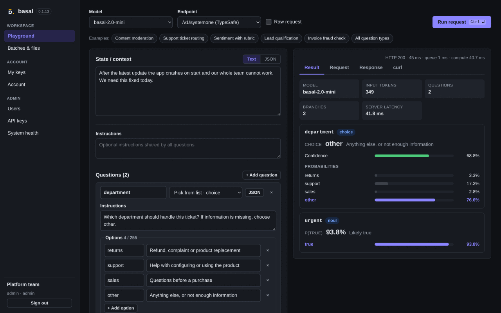

# Interfejs w przeglądarce

`basal serve --ui` (albo YAML `ui.enabled: true`) udostępnia pod `/ui/` interfejs
w przeglądarce. Moduł jest domyślnie wyłączony. Bez niego trasa `/ui` nie istnieje,
a API działa jak dotąd.

Strony są wkompilowane w binarkę (`crates/basal-cli/ui/`). To zwykły HTML, CSS
i moduły JavaScript, bez kroku budowania, zależności npm i zasobów z innych domen.

| Widok | Kto | Co robi |
|---|---|---|
| Playground | każdy (z `auth`: zalogowany) | żądanie `/v1/systemone` albo `/v1/basal`: stan JSON, instrukcje, pytania z kreatora, wynik oraz surowe żądanie, odpowiedź i `curl` |
| Batches & files | każdy (z `auth`: zalogowany), gdy działa Batch API | własne batche i pliki: lista, szczegóły, anulowanie, usuwanie, pobieranie, upload JSONL i utworzenie batcha |
| My keys, Account | zalogowany | własne klucze API (tworzenie, zakresy, wygasanie, odwołanie), zmiana hasła |
| Users, API keys | administrator | użytkownicy (tworzenie, hasło, blokada, usunięcie, zużycie quota Batch) i klucze wszystkich użytkowników |
| Server | administrator; tylko z `auth` | statystyki procesu na żywo: przetwarzanie, tory silnika, cache prefiksów, GPU i host, konfiguracja, ostatnie żądania ([niżej](#widok-server)) |
| System health | administrator; bez `auth` każdy | `/health`, `/health/batches`, `/v1/models` i wybrane metryki `/metrics` (z `--metrics`), odświeżane co 5 s |



Pozostałe widoki: [serwer](assets/ui/11-server-overview.png), [logowanie](assets/ui/01-login.png), [użytkownicy](assets/ui/02-admin-users.png),
[klucze API](assets/ui/03-admin-api-keys.png), [stan systemu](assets/ui/04-admin-health.png),
[kreator pytań](assets/ui/06-playground-question-builder.png),
[batche i pliki](assets/ui/07-user-batches-files.png), [własne klucze](assets/ui/08-user-my-keys.png),
[konto](assets/ui/10-user-account.png).

## Konfiguracja

```yaml
auth:
  enabled: true        # konta i logowanie; bez auth UI nie ma logowania

ui:
  enabled: true        # domyślnie false; także basal serve --ui
  session_ttl: 12h     # czas życia sesji logowania, od 5m do 30d
  cookie_secure: true  # false tylko dla dostępu przez HTTP inny niż localhost
  capture_requests: false  # treść ostatnich 200 żądań dla administratorów; wymaga auth
```

Z `auth` strony wymagają logowania kontem z `basal users`. Bez `auth` nie ma kont:
każdy, kto dociera do serwera, korzysta z Playground, health i Batch API
właściciela `batches.owner`, tak samo jak z samego API. Serwer wypisuje wtedy
ostrzeżenie przy starcie.

## Konta

Kontem jest użytkownik kluczy API ([AUTH.md](AUTH.md)). Schemat bazy w wersji 4
dodaje mu rolę (`user` albo `admin`) i opcjonalne hasło. Pierwszego administratora
tworzy operator:

```sh
basal database migrate --config serve.yml        # SQLite z auto_migrate robi to sam
printf '%s\n' "$ADMIN_PASSWORD" | basal users create --config serve.yml ops \
  --name "Operatorzy" --admin --password-stdin
basal serve --config serve.yml --auth --ui
```

Hasło ma co najmniej 12 znaków i jest czytane z pierwszej linii stdin, nigdy
z argumentu. `basal users password USER` ustawia je ponownie, a z `--clear` usuwa.
Użytkownik bez hasła nie zaloguje się do UI, ale jego klucze działają.
Administrator w UI może też tworzyć użytkowników i ustawiać im hasła.

- **Użytkownik** widzi wyłącznie swoje klucze, pliki i batche. Może tworzyć klucze
  z zakresami `inference`, `batches` i `mcp` oraz odwoływać własne klucze.
- **Administrator** ma te same możliwości, a ponadto zarządza wszystkimi
  użytkownikami i kluczami, także z zakresem `metrics`. Nie może zablokować ani
  usunąć własnego konta. Własne hasło zmienia na stronie Account, podając obecne.

## Sesje i bezpieczeństwo

- Hasła są przechowywane jako hash argon2id (PHC, 19 MiB, 2 przebiegi, losowa
  sól). Serwer liczy najwyżej dwa hashe naraz. Nieznany użytkownik, brak hasła,
  złe hasło i wyłączony użytkownik dają tę samą odpowiedź 401 po tej samej pracy.
- Po 10 nieudanych próbach jednego identyfikatora w ciągu 15 minut proces odrzuca
  kolejne próby (429 `too_many_attempts`) do końca okna. Licznik jest w pamięci
  procesu, osobno na każdej replice, i obejmuje najwyżej 10 000 identyfikatorów
  (przy pełnym najpierw wypadają wygasłe okna, potem najstarsze). Niepoprawny
  składniowo identyfikator dostaje 401 od razu, bez liczenia hasha.
- Logowanie tworzy sesję tylko wtedy, gdy hasło w bazie jest nadal tym sprawdzonym.
  Równoległa zmiana hasła unieważnia więc trwające logowanie.
- Sesja to losowy token (256 bitów) w ciasteczku `basal_session` z atrybutami
  `HttpOnly`, `SameSite=Strict`, `Path=/` i `Secure`. Baza przechowuje tylko jego
  SHA-256 (`api_sessions`). Sesja wygasa po `session_ttl` od zalogowania. Wylogowanie
  ją usuwa.
- Serwer odczytuje sesję z bazy przy każdym żądaniu, bez cache. Wylogowanie,
  zablokowanie użytkownika i zmiana hasła działają więc od razu. Zmiana hasła kończy
  pozostałe sesje użytkownika.
- Każde żądanie z ciasteczkiem sesji musi mieć nagłówek `X-Basal-UI: 1`, inaczej
  serwer zwraca 403 `ui_header_required`. Przeglądarka wysyła taki nagłówek do innej
  domeny dopiero po zgodzie CORS, której serwer nigdy nie daje. Strona innej domeny
  nie wykona więc żądania z sesją użytkownika (ochrona CSRF).
- Sesja daje zakresy `inference` i `batches`, a administratorowi także `metrics`.
  Strony korzystają z tych samych tras `/v1/…` co klienci API, w przestrzeni danych
  zalogowanego użytkownika. Klucze API nie otwierają tras `/ui/api/…`.
- Odpowiedzi `/ui` mają nagłówek Content-Security-Policy, który dopuszcza wyłącznie
  skrypty, style i żądania tego serwera. Blokuje kod inline i osadzanie w ramkach
  (`frame-ancestors 'none'`). Dochodzą `X-Content-Type-Options: nosniff`,
  `Referrer-Policy: no-referrer`, a w API `Cache-Control: no-store`.
- Bez TLS hasło i ciasteczko są widoczne w sieci. Przeglądarki nie zapisują
  ciasteczka `Secure` dla zwykłego HTTP poza `localhost`. Wystawiaj serwer za
  proxy z TLS; `cookie_secure: false` służy tylko testom w zaufanej sieci.

## Widok Server

Widok dla administratorów, przeznaczony także do udostępnienia poza maszynę.
Istnieje tylko z `auth`: bez kont serwer nie zbiera tych statystyk i nie ma ich tras.
Strona odpytuje serwer co sekundę. Przycisk Pause wstrzymuje odświeżanie, a Reset
state zeruje statystyki procesu (bez wpływu na `/metrics`).

| Zakładka | Zawartość |
|---|---|
| Overview | model, status (Ready, Serving albo status `/health`), wersja, czas działania; żądania i błędy, żądania/s z ostatnich 10 s i średnia od startu, p90 opóźnienia, żądania w toku, GPU; wykresy przepustowości i opóźnień (p90, p99, średnia z 10 s); tabela endpointów; state cache; GPU; host |
| Profile | tory silnika (`main`, `long`) każdej repliki: partie, żądania, średnia wielkość i czas partii, średni czas w kolejce, tokeny wejściowe, pytania, oczekujące, nieudane partie; wykres żądań w toku |
| Telemetry | każdy GPU: wykorzystanie, obciążenie szyny pamięci, pamięć całkowita, zajęta i zajęta przez ten proces, moc i limit, temperatura, zegar SM, wykresy; host: CPU, RAM, load 1/5/15, RSS, CPU i wątki procesu |
| Configuration | czas startu, urządzenia, limity i funkcje serwera; dla modeli instancje, `max_batch_tokens`, `schedule`, `long_tokens` i opis silnika (`Backend::describe`, jak w raportach) |
| Requests | ostatnie 200 żądań: czas, endpoint, model, status, opóźnienie, pytania, tokeny wejściowe, wielkość partii; po kliknięciu panel z zakładkami JSON i Metrics |

### Źródła danych

- **Żądania.** Middleware na trasach `/v1/systemone`, `/v1/basal` i `/v1/decisions`
  liczy każde żądanie z kodem HTTP i czasem od wejścia do zbudowania odpowiedzi,
  tak jak `basal_http_*`. Porzucony handler ma status `cancelled` i nie trafia do
  percentyli. Błąd to status od 400 albo `cancelled`. Percentyle od startu pochodzą
  z histogramu logarytmicznego (8 przedziałów na podwojenie, błąd względny poniżej
  5 %). Percentyle sekundowe na wykresach są dokładne. `/mcp` nie jest liczone.
- **Kolejka, partie, tokeny.** Wątek modelu po każdej partii dopisuje jej czas,
  wielkość, czasy kolejki oraz `usage.input_tokens` i `usage.questions` odpowiedzi.
  Żądania w toku to `running` i `queued` z `/health`. Pytania i tokeny pojedynczego
  żądania pochodzą z `usage` odpowiedzi 200 do 64 KiB, a czasy kolejki i partii
  z nagłówków `x-basal-*`.
- **Cache.** Silnik Llama (Basal 1.5, 2.0 i 2.5 mini/4.5B/max) ma stałe prefiksy
  szablonu i opcjonalny state cache (`state_cache_mb`, LRU w bajtach). Widok pokazuje
  budżet, zajęte bajty, wpisy, trafienia, chybienia (wiersze bez stanu z cache przy
  włączonym cache), wstawienia, usunięcia oraz trafienia prefiksów szablonu. Liczniki
  są osobne dla każdego toru, a widok je sumuje. Gemma (Omni) i Qwen3.5 nie mają
  tych cache'y; widok pokazuje wtedy brak danych. Tabela GEMM jest wybierana przy
  starcie i nie ma liczników w trakcie pracy.
- **GPU.** Na CUDA z NVML (`libnvidia-ml.so.1` ze sterownika, ładowana w trakcie
  działania): wykorzystanie, szyna pamięci, pamięć, moc i limit, temperatura, zegar
  SM oraz pamięć tego procesu. Urządzenie jest wyszukiwane po adresie PCI, więc
  numeracja zgadza się z `device` także przy `CUDA_VISIBLE_DEVICES`. Bez NVML pozostaje
  pamięć z CUDA. Na Metal: rekomendowany working set i alokacje procesu; wykorzystania,
  mocy i temperatury nie ma. Na Vulkan (Intel): budżet i użycie sterty sterownika.
- **Host.** Linux: `/proc/stat`, `/proc/meminfo`, `/proc/self/status`; wszędzie
  `getloadavg` i `getrusage`. macOS: tylko CPU i load procesu, liczba rdzeni i RAM całkowity.

GPU i host są odczytywane raz na sekundę w osobnym wątku `ui-stats`, poza ścieżką
żądania. Ścieżka żądania dokłada jedną blokadę na żądanie i jedną na partię oraz
odczyt `usage` odpowiedzi 200 do 64 KiB.
Wpływ na przepustowość opisuje
[raport](../reports/basal-ui-server-view-2026-10-31/README.md).

### Treść żądań (`capture_requests`)

Domyślnie widok Requests pokazuje tylko wynik i czasy. `ui.capture_requests: true`
(albo `basal serve --ui-capture-requests`) zachowuje także treść żądania i odpowiedzi
ostatnich 200 żądań, wyłącznie w pamięci procesu. Opcja wymaga `auth`, a treść widzą
tylko administratorzy. Zachowywane są ciała z nagłówkiem `Content-Length` do 64 KiB,
bez kompresji. Większe, strumieniowane i skompresowane są tylko oznaczane. Gdy ciało
żądania nie dotrze w całości, serwer z tą opcją odpowiada zwykłym tekstem 400 zamiast
błędu w formacie trasy. Bufor zajmuje więc najwyżej około 25 MiB. Treść
może zawierać dane wrażliwe klientów; restart i Reset state ją usuwają.

### API widoku

| Trasa | Działanie |
|---|---|
| `GET /ui/api/admin/stats[?since=N]` | migawka: liczniki od resetu, endpointy, tory, telemetria, historia sekundowa po punkcie `N` (5 min); bez `since` także `config` |
| `POST /ui/api/admin/stats/reset` | zeruje liczniki, historię i ostatnie żądania procesu (204) |
| `GET /ui/api/admin/requests` | ostatnie żądania, od najnowszego |
| `GET /ui/api/admin/requests/{id}` | jedno żądanie; z `capture_requests` także `request` i `response` |

## API kont (`/ui/api`)

Wszystkie trasy poza `config`, `login` i `logout` wymagają sesji. `logout` usuwa
sesję z ciasteczka, jeśli istnieje, i zawsze czyści ciasteczko, także po wygaśnięciu
sesji; `login` i `logout` wymagają nagłówka `X-Basal-UI: 1`. Błędy mają postać
`{"error": {"message", "type", "param", "code"}}`, a czasy są w sekundach Unix.

| Trasa | Działanie |
|---|---|
| `GET /ui/api/config` | publiczne: `auth`, `batches`, `metrics`, `mcp`, `stats`, `version` |
| `POST /ui/api/login` | `{"user","password"}` → konto i ciasteczko; 401 `invalid_credentials`, 429 `too_many_attempts` |
| `POST /ui/api/logout` | usuwa sesję i ciasteczko (204) |
| `GET /ui/api/me` | `{"user": {...}, "scopes": [...]}` |
| `POST /ui/api/me/password` | `{"current_password","new_password"}` (204); złe hasło: 400 `wrong_password` |
| `GET /ui/api/me/keys[?all=true]` | własne klucze; `all` dodaje odwołane |
| `POST /ui/api/me/keys` | `{"name","scopes":[...],"expires_in":"90d"\|null}` → 201 `{"key","token"}`; token tylko raz |
| `POST /ui/api/me/keys/{id}/revoke` | odwołanie własnego klucza; cudzy klucz: 404 |
| `GET /ui/api/admin/users[?all=true]` | użytkownicy z liczbą aktywnych kluczy i zużyciem quota Batch |
| `POST /ui/api/admin/users` | `{"id","name","role","password"\|null}` → 201; zajęty identyfikator: 409 `user_exists` |
| `POST /ui/api/admin/users/{id}/disable`, `/enable` | blokada albo odblokowanie; własne konto: 409 `self` |
| `POST /ui/api/admin/users/{id}/password` | `{"password"\|null}`; kończy sesje użytkownika; własne konto: 409 `self` |
| `DELETE /ui/api/admin/users/{id}` | usunięcie z kluczami i sesjami; 409 `user_not_disabled`, `user_has_data`, `self` |
| `GET /ui/api/admin/keys[?user=U&all=true]` | klucze wszystkich albo jednego użytkownika |
| `POST /ui/api/admin/keys` | `{"user","name","scopes","expires_in"}` → 201 `{"key","token"}` |
| `POST /ui/api/admin/keys/{id}/revoke` | odwołanie dowolnego klucza |

Słabe hasło (krótsze niż 12 znaków) daje 400 `weak_password`. Konto bez uprawnień
administratora dostaje na trasach `admin` 403 `admin_required`.

## Ograniczenia

- Brak resetu hasła przez e-mail, MFA i SSO. Zapomniane hasło administrator ustawia
  w UI albo przez `basal users password`.
- Limit nieudanych logowań działa na identyfikator, nie na adres IP. Zalew prób
  może więc zablokować logowanie danego użytkownika na 15 minut.
- Wygasłe sesje są usuwane przy kolejnym logowaniu tego użytkownika, przy jego
  blokadzie i przy zmianie hasła. Sesje użytkownika, który więcej się nie loguje,
  zostają w bazie jako nieważne wiersze.
- Strony nie wspierają dialektu `upstream` na `/v1/systemone`. Playground wysyła
  wtedy żądania przez `/v1/basal`.
- Panel zdrowia pokazuje stan jednego procesu, który obsłużył żądanie.
- Widok Server też: statystyki są w pamięci procesu, osobno na każdej replice
  serwera, i znikają po restarcie. Historia obejmuje 5 minut.
